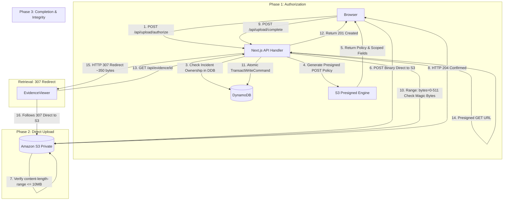

# VIGILORA AWS Amplify Hosting (SSR) Compatibility Audit

**Document**: `VIGILORA_AMPLIFY_COMPATIBILITY_AUDIT.md`  
**Date**: November 3, 2026 (Updated with Option A & Exact Limit Classifications)  
**Audit Scope**: Read-only technical evaluation of VIGILORA Next.js repository against AWS Amplify Hosting SSR specifications  
**Target AWS Region**: `eu-north-1` (Stockholm)  
**Target Account**: `399527676157`  
**Mandate**: Strictly read-only; zero code changes, zero package installations, zero AWS modifications, zero deployments.

---

## 1. Executive Summary & Verdict

### Final Verdict: **COMPATIBLE WITH CHANGES**
*(Status: **NOT CURRENTLY COMPATIBLE** in its current as-is repository state without architectural and configuration modifications).*

While VIGILORA's core Next.js App Router architecture and server-side AWS SDK v3 integration are conceptually aligned with AWS compute, two distinct infrastructure limitations in AWS Amplify Hosting SSR directly conflict with VIGILORA's current evidence handling implementation:

> [!CAUTION]
> **CRITICAL INFRASTRUCTURE BOTTLENECKS: REQUEST & RESPONSE CEILINGS**  
> 1. **Incoming Request Ceiling (AWS Lambda Synchronous Limit)**: AWS Amplify Hosting SSR routes all Route Handlers through **AWS Lambda**, which enforces a hard **6 MB (6,291,456 bytes)** synchronous request payload limit. In VIGILORA's current proxy upload design, any photo exceeding ~4.5 MB (accounting for multipart boundary and transfer overhead) will be rejected by the compute gateway with an unhandled `413 Request Entity Too Large` error before Next.js code executes.  
> 2. **Outgoing Response Ceiling (Documented Amplify SSR Limit)**: AWS Amplify Hosting Web Compute officially enforces a **5.72 MB (6,000,000 bytes)** maximum response payload size for server-rendered pages and API routes. In VIGILORA's current streaming viewer design (`GET /api/evidence/[id]`), streaming an image larger than 5.72 MB causes Amplify's edge layer to abort the connection with an immediate, empty **HTTP 504 Gateway Timeout**.

---

## 2. Item-by-Item Compatibility Audit

### Item 1: Exact Installed Next.js Version & Amplify Framework Compatibility
- **`package.json` specification**: `"next": "16.4.3"`
- **`package-lock.json` resolved**: `"16.4.3"`
- **Turbopack status**: Active in dev and build pipelines.
- **Amplify Managed Compatibility Reality**:
  - AWS Amplify Hosting officially documents native managed support for Next.js versions **12, 13, 14, and 15**.
  - Next.js 16 is a major release with significant architectural differences (Turbopack default, React 19, new stable platform adapter specs).
  - **Important Reality Check**: A custom build script (`nvm use 22`) in `amplify.yml` ensures Node runtime compatibility during build execution, but **does not guarantee framework compatibility**. Amplify's underlying serverless packaging adapter (OpenNext) must parse the `.next` output. If it encounters unexpected Next.js 16 manifests, builds will fail during the post-build packaging phase.
  - Turbopack symlinks can trigger `EEXIST` errors in Amplify's archive creator, and experimental Next.js 16 features like Partial Prerendering (PPR) require explicit deactivation.

---

### Item 2: Node.js Version & Build Engine Requirements
- **Current Local Node.js Runtime**: `v22.14.0` (Node.js 22 LTS, x64).
- **`package.json` engines field**: None specified (`"engines"` is currently missing).
- **Amplify Compatibility Analysis**:
  - AWS Amplify's default build container runs **Node.js 18** or **Node.js 20**.
  - Next.js 16 requires Node.js `>= 18.18.0` or `>= 20.9.0`. To align with local development and avoid runtime deprecation errors, Amplify's build specification (`amplify.yml`) must explicitly specify `nvm use 22`.

---

### Item 3: API Route Runtime & Feature Analysis
All 14 Next.js API Route Handlers in `src/app/api/` were inspected:

| Route Handler | Configured Runtime | Node Core Modules Used | Edge Runtime Used? |
| :--- | :---: | :---: | :---: |
| `/api/activities` | `nodejs` (default) | AWS SDK v3 | No |
| `/api/auth/login` | `nodejs` (default) | `crypto` (`scryptSync`), AWS SDK v3 | No |
| `/api/auth/logout` | `nodejs` (default) | Next.js cookies | No |
| `/api/auth/revoke` | `nodejs` (default) | `crypto`, AWS SDK v3 | No |
| `/api/auth/session` | `nodejs` (default) | `crypto`, AWS SDK v3 | No |
| `/api/evidence/[id]` | `nodejs` (default) | `stream` (`Readable.toWeb`), S3 SDK | No |
| `/api/health/aws` | `nodejs` (default) | DynamoDB & S3 SDKs | No |
| `/api/incidents` | `nodejs` (default) | AWS SDK v3 | No |
| `/api/incidents/[id]` | `nodejs` (default) | AWS SDK v3 | No |
| `/api/incidents/[id]/assign` | `nodejs` (default) | AWS SDK v3 | No |
| `/api/settings` | `nodejs` (default) | AWS SDK v3 | No |
| `/api/teams` | `nodejs` (default) | AWS SDK v3 | No |
| `/api/teams/[id]` | `nodejs` (default) | AWS SDK v3 | No |
| `/api/upload` | `nodejs` (default) | `crypto`, S3 SDK, DynamoDB SDK | No |

- **Edge Runtime Findings**: **Zero** routes use the Edge runtime (`export const runtime = "edge"` is absent across all files).
- **Experimental Features in `next.config.ts`**:
  - `cacheComponents: true`
  - `partialPrefetching: true` (PPR)
  - *Risk*: `partialPrefetching` generates hybrid SSR/static manifests that frequently cause Amplify's OpenNext bundler to crash. PPR must be disabled (`partialPrefetching: false`) for Amplify deployment.

---

### Item 4 & 5: Upload Path Trace & Architectural Bottlenecks

#### Legacy Upload Flow (Current Repository State):
1. **Stage 1 (Browser)**: Client submits up to 10 MB file to `POST /api/upload`.
2. **Stage 2 (Compute Gateway)**: Amplify passes request through CloudFront to AWS Lambda.
   - *Failure Point*: Files > ~4.5 MB exceed Lambda's 6 MB synchronous payload limit ➔ **HTTP 413 Failure**.
3. **Stage 3 (Next.js Server)**: Server parses buffer, validates magic bytes, and calls `PutObjectCommand`.
4. **Stage 4 (Metadata)**: Server writes to DynamoDB.
5. **Stage 5 (Retrieval)**: Client calls `GET /api/evidence/[id]`. Server streams image from S3.
   - *Failure Point*: Images > 5.72 MB exceed Amplify's response limit ➔ **HTTP 504 Timeout Failure**.

---

### Item 6: Request, Response, Timeout & Streaming Limits

| Architectural Layer | Constraint / Parameter | Limit Value | Failure Mode | Impact on VIGILORA |
| :--- | :--- | :--- | :--- | :--- |
| **AWS Lambda (Amplify SSR)** | **Synchronous Request Payload** | **6 MB** *(6,291,456 bytes)* | Compute boundary drop with HTTP 413 | Client uploads > ~4.5 MB are rejected before reaching route handler. |
| **Amplify Web Compute** | **Max Response Payload** | **5.72 MB** *(6,000,000 bytes)* | Edge abort with HTTP 504 Gateway Timeout | `GET /api/evidence/[id]` crashes when streaming images > 5.72 MB. |
| **Next.js Server Actions** | **Default Body Size** | **1 MB** | Request rejected by Next.js | Relevant if Server Actions are adopted. |
| **Amplify Function Timeout** | **Execution Duration** | **30 seconds** *(Default)* | Gateway timeout | Multipart upload + S3 PUT + DDB write risks 504 on 3G/4G networks. |
| **CloudFront / Amplify** | **Build Output Size** | **220 MB** *(SSR bundle)* | Build/deploy pipeline abort | SSR compute artifact must stay under 220 MB. |

---

### Item 7: Current AWS Account IAM Capability Check

Verification confirmed:
- Caller assumed role: `arn:aws:sts::399527676157:assumed-role/AccountFullAccessRole/...`
- Attached policy: `arn:aws:iam::aws:policy/AdministratorAccess`
- The AWS account has **full authority** to create, configure, and attach Amplify compute execution roles (`iam:CreateRole`, `iam:AttachRolePolicy`, `iam:PassRole`) when authorized.

---

### Item 8: The Solution: Option A (Direct S3 Presigned Uploads & Redirect Retrieval)

To preserve the **10 MB evidence upload limit** and comply with Amplify's 5.72 MB response limit, **Option A** is the recommended architecture:

#### Why Presigned POST is Chosen Over Presigned PUT:
- **Presigned POST (`@aws-sdk/s3-presigned-post`)** supports declarative policy conditions:
  - `['content-length-range', 1, 10485760]` (1 byte to 10 MB).
  - Amazon S3 cryptographically terminates any upload > 10 MB at the edge before storage.
- **Presigned PUT** does not support range conditions and cannot enforce a maximum size ceiling without signed exact byte headers or post-upload server cleanup.

#### S3 Security & CORS:
- **Bucket Remains 100% Private**: All S3 Public Access Block settings remain `true`.
- **Zero AWS Credentials in Browser**: Only a temporary HMAC-SHA256 signature scoped to a single object key is issued (expires in 300 seconds).
- **Exact-Origin CORS**: Restricts uploads strictly to the production Amplify domain and `localhost:3000`.

---

## 3. Alternative Hosting Assessment (App Runner vs Amplify)

| Hosting Platform | Next.js 16 Compatibility | Payload Limits | Operational Cost | Suitability |
| :--- | :---: | :---: | :---: | :--- |
| **AWS Amplify Hosting (SSR)** | Experimental (Docs list up to v15) | 6 MB req / 5.72 MB res (bypassed via Option A) | **$0** (Free Tier) | Recommended if zero financial cost is paramount. |
| **AWS App Runner (Container)** | **100% Native** (Runs standalone Node 22) | **100 MB** (Configurable proxy) | ~$5 to $10 / month | **Recommended for production stability** and uncompromised Next.js 16 support. |

---

## 4. Conclusion & Decision Gate

- **As-Is Repository Compatibility**: **NOT CURRENTLY COMPATIBLE** (Will fail on uploads >4.5 MB due to Lambda's 6 MB limit; will fail on retrieval >5.72 MB; missing `amplify.yml`).
- **Post-Option A Compatibility**: **COMPATIBLE WITH CHANGES** (Requires Option A Presigned POST, 307 redirect retrieval, `amplify.yml`, and disabling experimental PPR).

**Refer to [`VIGILORA_OPTION_A_PRESIGNED_PROPOSAL.md`](file:///c:/Users/testp/Desktop/PROJECTS/VIGILORA/VIGILORA_OPTION_A_PRESIGNED_PROPOSAL.md) for full architectural specifications, failure remediation strategies, and the 6-scenario test plan.**
