# VIGILORA Technical Proposal: Direct Browser-to-S3 Presigned Evidence Architecture (Option A) & Next.js 16 Hosting Evaluation

**Document**: `VIGILORA_OPTION_A_PRESIGNED_PROPOSAL.md`  
**Date**: November 3, 2026  
**Status**: Proposal & Readiness Investigation — Strictly Read-Only  
**Target AWS Region**: `eu-north-1` (Stockholm)  
**Target Account**: `399527676157`  
**Author**: Antigravity Technical Lead  

---

## 1. Executive Summary

This proposal presents the architectural design for **Option A**: preserving VIGILORA's **10 MB evidence upload limit** by transitioning from server-buffered proxy uploads to **direct browser-to-S3 uploads using short-lived presigned permissions**, paired with **short-lived presigned GET redirects for authorized evidence retrieval**.

In addition, this document corrects critical infrastructure limit classifications, presents an in-depth comparative analysis of **Presigned POST vs Presigned PUT**, evaluates **Next.js 16.4.3 compatibility on AWS Amplify Hosting**, and provides a **comprehensive 6-scenario test plan** and **final hosting recommendation**.

> [!IMPORTANT]
> **COMPLIANCE & GOVERNANCE BOUNDARY**  
> In accordance with user instructions, this document is strictly an architectural specification. No application code has been modified, no dependencies have been installed, no AWS configurations have been altered, and no deployments have been triggered. All actions remain paused pending operator review and approval.

---

## 2. Infrastructure Limit Correction: Request vs Response Boundaries

A rigorous examination of AWS Amplify Hosting SSR and AWS serverless primitives reveals two distinct, independent infrastructure constraints that were conflated in initial assessments:

```
+---------------------------------------------------------------------------------------------------------+
|                                    AWS AMPLIFY HOSTING INFRASTRUCTURE                                    |
|                                                                                                         |
|   INCOMING REQUEST PATH (Upload):                                                                       |
|   Browser ──[10 MB Form]──> CloudFront ──> Managed Proxy ──> AWS Lambda (Next.js SSR)                   |
|                                                                 |                                       |
|                                                  HARD CEILING: 6 MB (6,291,456 bytes)                   |
|                                                  AWS Lambda Synchronous Request Payload Limit           |
|                                                                                                         |
|   OUTGOING RESPONSE PATH (Streaming Retrieval):                                                         |
|   Browser <──[Evidence Stream]── CloudFront <── AWS Amplify SSR Edge Layer <── AWS Lambda (Next.js SSR) |
|                                                      |                                                  |
|                                       HARD CEILING: 5.72 MB (6,000,000 bytes)                           |
|                                       Documented Amplify Hosting SSR Max Response Payload Limit         |
|                                       (Breach triggers immediate HTTP 504 Gateway Timeout)              |
+---------------------------------------------------------------------------------------------------------+
```

### Detailed Limit Classification:

| Architectural Plane | Infrastructure Boundary | Exact Limit Value | Operational Failure Mechanism | Impact on VIGILORA Legacy Proxy |
| :--- | :--- | :--- | :--- | :--- |
| **Incoming Request (Upload)** | **AWS Lambda Execution Context** | **6 MB** *(6,291,456 bytes)* | AWS Lambda synchronous invocation limit. If request payload (including MIME boundary and base64/binary transfer overhead) exceeds 6 MB, the Lambda invocation fails with `413 Request Entity Too Large` before Next.js code executes. | Files between ~4.5 MB and 10 MB are dropped at the compute gateway. |
| **Incoming Request (Actions)** | **Next.js Framework Default** | **1 MB** *(configurable)* | Next.js Server Actions enforce a default 1 MB `bodySizeLimit` (unless overridden in `next.config.ts`). | Not applicable to App Router Route Handlers, but relevant if Server Actions are introduced. |
| **Outgoing Response (Retrieval)** | **AWS Amplify Hosting Web Compute** | **5.72 MB** *(6,000,000 bytes)* | **Documented Amplify SSR Limit**. Amplify's edge proxy buffers server-rendered pages and API responses. If the response stream exceeds 6,000,000 bytes, Amplify immediately aborts the connection and returns an empty **HTTP 504 Gateway Timeout**. | `GET /api/evidence/[id]` crashes whenever streaming an evidence image larger than 5.72 MB. |
| **Compute Execution Timeout** | **Amplify Serverless Function** | **30 Seconds** *(Default)* | Requests taking longer than 30 seconds are terminated by the edge gateway. | Uploading 10 MB on slow mobile networks plus S3 PUT and DynamoDB writes risks 504 timeouts. |

**Key Takeaway**: Both the upload path (6 MB Lambda request limit) and the retrieval path (5.72 MB Amplify response limit) are hard bottlenecks under server-mediated streaming. **Option A completely bypasses both limits** by moving binary transfers directly to Amazon S3.

---

## 3. Presigned POST vs Presigned PUT Investigation

To enforce the 10 MB limit securely, we evaluated whether **Presigned POST** (`createPresignedPost`) or **Presigned PUT** (`PutObjectCommand` + `getSignedUrl`) is technically superior:

| Evaluation Criteria | S3 Presigned PUT (`getSignedUrl`) | S3 Presigned POST (`createPresignedPost`) | Architectural Winner |
| :--- | :--- | :--- | :---: |
| **Size Limit Enforcement Mechanism** | Signs the HTTP `Content-Length` header for an exact byte count. Does **not** support dynamic size range policies. | Uses an S3 POST Policy document supporting: `['content-length-range', 1, 10485760]`. | **Presigned POST** |
| **S3 Storage Layer Enforcement** | If the client lies or the header is omitted from signature, S3 will accept uploads up to **5 GB**. Oversized uploads must be deleted post-facto. | S3 cryptographically verifies bytes as they arrive. If bytes exceed 10 MB, S3 **terminates the upload at the edge** with `400 EntityTooLarge`. | **Presigned POST** |
| **MIME Type Validation** | Signs `ContentType` header. | Policy condition: `['eq', '$Content-Type', mimeType]` or `['starts-with', '$Content-Type', 'image/']`. | Tie |
| **Server-Side Encryption Enforcement** | Signed header `x-amz-server-side-encryption: AES256`. | Policy condition: `['eq', '$x-amz-server-side-encryption', 'AES256']`. | Tie |
| **Browser Upload Transport** | Raw binary body via `fetch(url, { method: 'PUT', body: file })`. Simple headers. | `multipart/form-data` via `fetch(url, { method: 'POST', body: formData })`. Fields must precede file. | Presigned PUT (simpler) |
| **AWS SDK Package Requirement** | `@aws-sdk/s3-request-presigner` | `@aws-sdk/s3-presigned-post` | Tie (both lightweight) |

### Technical Conclusion:
**S3 Presigned POST is selected**.  
Only Presigned POST provides **declarative, cryptographic enforcement of the 10 MB size ceiling (`content-length-range: [1, 10485760]`) directly at the S3 edge boundary**. Presigned PUT cannot enforce a maximum size range without requiring the server to know the exact byte count in advance or trusting client-declared headers.

---

## 4. End-to-End Option A Upload & Metadata Architecture

```mermaid
sequenceDiagram
    autonumber
    actor Client as Operator Browser
    participant API as Next.js API (/api/upload/*)
    participant S3 as Amazon S3 (eu-north-1)
    participant DDB as DynamoDB (VIGILORA-Main)

    Note over Client, DDB: PHASE 1: UPLOAD AUTHORIZATION & POLICY GENERATION
    Client->>API: POST /api/upload/authorize<br/>{ incidentId, filename, mimeType, sizeBytes }<br/>[Cookie: vigilora_session]
    API->>API: 1. Authenticate session & verify Operator RBAC<br/>2. Verify incident exists in caller's campus (DDB)<br/>3. Validate mimeType (JPEG/PNG/WebP) & sizeBytes <= 10 MB
    API->>API: 4. Generate S3 Presigned POST data via @aws-sdk/s3-presigned-post<br/>   - Policy: content-length-range [1, 10485760]<br/>   - Encryption: AES256<br/>   - Key: evidence/{campusId}/{incidentId}/{uuid}.{ext}<br/>   - Expiry: 300 seconds (5 min)
    API-->>Client: HTTP 200 OK<br/>{ uploadUrl, fields, evidenceId, key, expiresAt }

    Note over Client, S3: PHASE 2: DIRECT BROWSER-TO-S3 BINARY UPLOAD
    Client->>Client: Construct FormData(fields + file)
    Client->>S3: POST https://vigilora-evidence-...s3.eu-north-1.amazonaws.com<br/>[Direct multipart/form-data]
    rect rgb(20, 60, 20)
    Note over S3: Amazon S3 Edge Verification:<br/>- Validates HMAC signature & policy<br/>- Enforces content-length-range <= 10 MB<br/>- Enforces AES-256 encryption
    S3-->>Client: HTTP 204 No Content (ETag confirmed)
    end

    Note over Client, DDB: PHASE 3: COMPLETION VERIFICATION & METADATA TRANSACTION
    Client->>API: POST /api/upload/complete<br/>{ evidenceId, incidentId, key, mimeType, sizeBytes }<br/>[Cookie: vigilora_session]
    API->>API: 1. Authenticate session & verify RBAC
    API->>S3: HeadObjectCommand(key) -> Verify object exists, size <= 10MB
    API->>S3: GetObjectCommand(key, Range: "bytes=0-511")
    S3-->>API: First 512 bytes stream
    API->>API: 2. Validate Magic Bytes (JPEG/PNG/WebP signature)
    alt Magic Bytes Invalid or Mismatched
        API->>S3: DeleteObjectCommand(key) [Rollback]
        API-->>Client: HTTP 400 Bad Request (Invalid file signature)
    else Magic Bytes Valid
        API->>DDB: TransactWriteCommand<br/>- Put EVIDENCE#{evidenceId} (ACTIVE)<br/>- Update INCIDENT#{incidentId} (hasPhoto=true, photoUrl=/api/evidence/{id})<br/>- Put ACTIVITY#{activityId} (Evidence attached)
        DDB-->>API: Transaction Committed
        API-->>Client: HTTP 201 Created<br/>{ success: true, evidenceId, photoUrl: "/api/evidence/ev-..." }
    end
```



### 1. Upload Authorization Endpoint (`POST /api/upload/authorize`)
- **Request Body**:
  ```json
  {
    "incidentId": "inc-1730648900000",
    "filename": "perimeter-breach.jpg",
    "mimeType": "image/jpeg",
    "sizeBytes": 4829104
  }
  ```
- **Validation**:
  - Validates active operator session from HttpOnly cookie.
  - Verifies `incidentId` exists in DynamoDB under caller's campus partition (`CAMPUS#METROPOLIS`).
  - Verifies `mimeType` is in `['image/jpeg', 'image/png', 'image/webp']`.
  - Verifies `sizeBytes > 0 && sizeBytes <= 10485760`.
- **Policy Conditions**:
  ```javascript
  const { url, fields } = await createPresignedPost(s3Client, {
    Bucket: process.env.S3_EVIDENCE_BUCKET,
    Key: `evidence/${campusId}/${incidentId}/${crypto.randomUUID()}.${ext}`,
    Conditions: [
      ['content-length-range', 1, 10485760],
      ['eq', '$Content-Type', mimeType],
      ['eq', '$x-amz-server-side-encryption', 'AES256'],
    ],
    Fields: {
      'Content-Type': mimeType,
      'x-amz-server-side-encryption': 'AES256',
    },
    Expires: 300, // 5 minutes
  });
  ```

### 2. Direct S3 Upload
- Browser sends `POST` directly to S3 with `FormData`.
- S3 evaluates the policy. If size > 10 MB, S3 aborts upload and returns `400 EntityTooLarge`.
- Browser receives `204 No Content` and `ETag`.

### 3. Upload Completion Endpoint (`POST /api/upload/complete`)
- Browser sends `{ evidenceId, incidentId, key, mimeType, sizeBytes }`.
- Server executes `HeadObjectCommand` on S3:
  - Confirms object exists.
  - Verifies `ContentLength <= 10485760`.
  - Confirms `ServerSideEncryption === 'AES256'`.
- **512-Byte Range Magic Byte Integrity Check**:
  - Server issues `GetObjectCommand` with `Range: "bytes=0-511"`.
  - Downloads only **512 bytes** (latency ~20ms, negligible RAM impact).
  - Inspects file signature:
    - JPEG: `FF D8 FF`
    - PNG: `89 50 4E 47 0D 0A 1A 0A`
    - WebP: `52 49 46 46` ... `57 45 42 50`
  - If invalid, executes `DeleteObjectCommand` and aborts.
- **DynamoDB Transaction (`TransactWriteCommand`)**:
  - `Put` `EVIDENCE#${evidenceId}` record with `attribute_not_exists(PK)`.
  - `Update` `INCIDENT#${incidentId}` setting `hasPhoto = true` and `photoUrl = /api/evidence/${evidenceId}`.
  - `Put` `ACTIVITY#${activityId}` audit trail record.

---

## 5. Authorized Evidence Retrieval via Short-Lived Presigned GET URLs

To resolve the **5.72 MB Amplify SSR response limit** without compromising security:

```mermaid
sequenceDiagram
    autonumber
    actor Client as Operator Browser (EvidenceViewer)
    participant API as GET /api/evidence/[id]
    participant DDB as DynamoDB (VIGILORA-Main)
    participant S3 as Amazon S3 (eu-north-1)

    Client->>API: GET /api/evidence/ev-9b1d8e2...<br/>[Cookie: vigilora_session]
    API->>API: 1. Authenticate session & verify Operator RBAC
    API->>DDB: GetItem (EVIDENCE#ev-9b1d8e2...)
    DDB-->>API: Item { s3Key, campusId, mimeType, status }
    API->>API: 2. Enforce Campus Isolation (caller campus == item campus)
    API->>API: 3. Generate Presigned GET URL via @aws-sdk/s3-request-presigner<br/>   - Command: GetObjectCommand(Bucket, Key)<br/>   - ExpiresIn: 120 seconds (2 minutes)
    API-->>Client: HTTP 307 Temporary Redirect<br/>Location: https://vigilora-evidence-...s3.eu-north-1.amazonaws.com/evidence/...<br/>[Payload: ~350 bytes]
    
    rect rgb(20, 60, 20)
    Note over Client, S3: BROWSER AUTOMATICALLY FOLLOWS 307 TO S3
    Client->>S3: GET https://vigilora-evidence-...s3... (Presigned Signature)
    S3-->>Client: HTTP 200 OK (Full Binary Image, TLS, Streamed directly from S3)
    end
```



### Key Architectural Benefits:
1. **Preserves Existing UI & Canonical URLs**: Frontend `` and `EvidenceViewer` components require **zero URL structure changes**. Browsers automatically follow HTTP 307 redirects.
2. **Zero Response Size Bottleneck**: The API response payload from Next.js is ~350 bytes (standard redirect headers), eliminating all risk of hitting Amplify's 5.72 MB response ceiling.
3. **Short Expiration (120 seconds)**: Prevents permanent public link leakage. URLs expire within 2 minutes of generation.
4. **Campus Isolation & RBAC**: Every request is authenticated against the session cookie and verified against DynamoDB records before the presigned GET URL is issued.

---

## 6. S3 Security Posture & Exact-Origin CORS Configuration

### Private Bucket Enforcement:
- Amazon S3 Public Access Block remains fully enabled (`BlockPublicAcls: true`, `IgnorePublicAcls: true`, `BlockPublicPolicy: true`, `RestrictPublicBuckets: true`).
- The bucket contains **zero public read or write permissions**.
- No credentials or long-term IAM tokens are exposed to the browser. The browser receives only an HMAC-SHA256 signature scoped strictly to a single S3 object key.

### Exact-Origin CORS Configuration:
Direct browser uploads require an S3 CORS policy. In accordance with zero-trust security, wildcards (`*`) are prohibited:

```json
[
  {
    "AllowedOrigins": [
      "https://main.<amplify-app-id>.amplifyapp.com",
      "https://vigilora.campus.edu",
      "http://localhost:3000"
    ],
    "AllowedMethods": ["POST", "GET", "HEAD"],
    "AllowedHeaders": [
      "Content-Type",
      "x-amz-*",
      "Authorization",
      "Origin",
      "Accept"
    ],
    "ExposeHeaders": ["ETag"],
    "MaxAgeSeconds": 3600
  }
]
```

---

## 7. Failure Modes, Edge Cases & Orphaned Object Remediation

| Failure Scenario | Threat / Failure Mode | Automated Mitigation Strategy |
| :--- | :--- | :--- |
| **Abandoned Upload** | Client receives presigned URL but closes tab, loses power, or disconnects before uploading. | 1. Presigned policy expires in 300s.<br/>2. S3 Lifecycle Rule configured to abort incomplete multipart uploads after 1 day.<br/>3. Staged S3 objects with no corresponding active DynamoDB record are cleaned up via an automated S3 Lifecycle rule or scheduled reconciliation task. |
| **Expired URL** | Client experiences severe network latency (>5 minutes) while uploading. | S3 terminates request with `403 RequestTimeTooSkewed` or `AccessDenied`. Client UI catches 403, notifies operator, and prompts one-click retry. |
| **Duplicate Requests** | Operator double-clicks submit or network retransmits. | 1. Client disables submit button immediately upon click.<br/>2. Authorization endpoint generates unique `evidenceId` (`ev-${uuid}`).<br/>3. Completion endpoint enforces `attribute_not_exists(PK)` in DynamoDB transaction. |
| **Metadata Write Failure** | S3 upload succeeds, but DynamoDB `TransactWriteCommand` fails (e.g. throughput spike, network partition). | The completion route catches the error and immediately issues `DeleteObjectCommand` to S3, rolling back the uploaded file so no orphaned S3 objects persist. |
| **Tampered / Fake Image** | Malicious client renames `.exe` to `.jpg` and uploads valid size. | S3 stores payload, but the completion endpoint performs a **512-byte Range check**. When magic bytes fail to match JPEG/PNG/WebP, server deletes object from S3 and returns HTTP 400. |

---

## 8. Next.js 16.4.3 Managed Amplify Compatibility Reality Check

A critical aspect of production readiness is assessing whether **Next.js 16.4.3** can be reliably hosted on AWS Amplify Hosting:

```
+---------------------------------------------------------------------------------------------------+
|                                NEXT.JS 16 vs AMPLIFY SSR MATRIX                                   |
|                                                                                                   |
|  Next.js 16.4.3 Feature         Amplify Web Compute Status         Risk Level & Impact            |
|  ─────────────────────────────  ─────────────────────────────────  ─────────────────────────────  |
|  1. Node.js 22 LTS Runtime      Supported via amplify.yml          LOW: Solved by nvm use 22      |
|  2. Official Framework Cert.    Officially lists v12 - v15 only    HIGH: Ahead of managed runtime |
|  3. Turbopack Compiler Engine   Can cause symlink/EEXIST errors    MEDIUM: Requires fallback test |
|  4. Partial Prerendering (PPR)  Adapter incompatibility risk       CRITICAL: Must be disabled     |
|  5. React 19 Server Components  Hydration/SSR stream mismatches    MEDIUM: Edge streaming caveats |
|  6. 220 MB Compute Bundle Limit Strict Lambda bundle cap           MEDIUM: Requires bundle audit  |
+---------------------------------------------------------------------------------------------------+
```

### Deep Compatibility Analysis:
1. **The Custom Build Configuration Fallacy**: While adding `nvm use 22` in `amplify.yml` solves the Node.js runtime version during the build phase, it **does not solve framework packaging differences**. Amplify's underlying SSR compute adapter (OpenNext) packages Next.js outputs into serverless Lambda bundles. If the adapter encounters unexpected Next.js 16 build manifests, the deployment will fail during the packaging phase regardless of Node version.
2. **Experimental PPR (`partialPrefetching: true`)**: Currently enabled in VIGILORA's `next.config.ts`. In Next.js 16, PPR generates hybrid pre-rendering manifests that Amplify's current SSR compute wrapper does not officially support. **PPR must be disabled (`partialPrefetching: false`)** before deploying to Amplify.
3. **Turbopack Build Bundling**: Next.js 16 uses Turbopack by default. On some containerized build environments, Turbopack's file system symlinks have caused `EEXIST` errors during the creation of Amplify's deployment zip archive.

---

## 9. Comprehensive 6-Scenario Test Plan

The following test suite will verify the Option A architecture across all size boundaries and security controls:

| Test ID | Scenario | File Type | Exact Size | Verification Mechanism | Expected Result | Pass Criteria |
| :---: | :--- | :---: | :---: | :--- | :--- | :--- |
| **TC-1** | **Standard Valid Upload** | Genuine JPEG | 2.5 MB | Browser uploads to S3; calls completion; checks DDB and S3. | HTTP 204 from S3; HTTP 201 from completion; DDB record active; photo visible in viewer. | Verified ETag, DDB metadata present, valid image rendering. |
| **TC-2** | **Boundary: Exactly at Limit** | Genuine PNG | Exactly 10,485,760 bytes *(10.0 MB)* | Upload authorized with declared size; S3 policy checks `content-length-range [1, 10485760]`. | S3 accepts upload (204 No Content); completion endpoint confirms exact size match and magic bytes. | Full 10 MB payload stored and accessible without truncation. |
| **TC-3** | **Boundary: Just Above Limit** | JPEG | Exactly 10,485,761 bytes *(10 MB + 1 byte)* | 1. Client-side pre-validation.<br/>2. Direct raw POST to S3 bypassing client UI. | 1. UI rejects: *"File exceeds 10 MB limit"*; upload aborted.<br/>2. S3 edge rejects raw POST with `400 EntityTooLarge`. | Zero bytes stored in S3; zero records in DynamoDB. |
| **TC-4** | **Substantial Oversize** | MP4 / Large Image | 25 MB | Client file picker selection and direct POST attempt. | UI immediately blocks submission; direct S3 POST terminated immediately by S3 policy engine. | Zero upload progress allowed; clean UI error message. |
| **TC-5** | **Magic Byte Tampering** | Shell script / EXE renamed to `.jpg` | 1.2 MB | Client uploads file with fake `image/jpeg` header. | S3 accepts payload, but completion endpoint inspects first 512 bytes, detects invalid magic bytes, triggers S3 `DeleteObjectCommand`. | Completion returns `400 Bad Request`; file purged from S3; zero DDB records. |
| **TC-6** | **Retrieval Response Boundary** | Genuine JPEG | 8.2 MB | Browser loads `` or opens EvidenceViewer. | API returns `HTTP 307 Temporary Redirect` (payload ~350 bytes); browser follows 307 directly to S3. | Zero 5.72 MB Amplify ceiling errors; zero 504 timeouts; image renders in high resolution. |

---

## 10. Final Recommendation: Hosting Architecture Evaluation

Based on the technical investigations into AWS Amplify Hosting SSR and Next.js 16.4.3, we provide three distinct hosting pathways:

```
+───────────────────────────────────────────────────────────────────────────────────────────────────+
|                                    AWS HOSTING ARCHITECTURE COMPARISON                             |
+─────────────────────────────+───────────────────────────────────+─────────────────────────────────+
| ARCHITECTURE OPTION         | KEY ADVANTAGES                    | KEY RISKS & TRADE-OFFS          |
+─────────────────────────────+───────────────────────────────────+─────────────────────────────────+
| OPTION 1:                   | • 100% Free Tier eligible         | • Next.js 16.4.3 is uncertified |
| AWS Amplify Hosting (SSR)   | • Managed SSL and global CDN      |   on Amplify (officially <= 15) |
| with Option A (Presigned)   | • Zero server management          | • Requires disabling PPR        |
|                             | • Automated CI/CD from Git        | • Strict 220 MB bundle limit    |
+─────────────────────────────+───────────────────────────────────+─────────────────────────────────+
| OPTION 2 (RECOMMENDED):     | • 100% Native Next.js 16 support  | • Incurs minor monthly charges  |
| AWS App Runner              | • Runs standalone Node 22 server  |   (~$5 to $10/month)            |
| (Containerized Next.js)     | • No 6 MB / 5.72 MB limits        | • Requires Docker container     |
| with Option A               | • Native IAM instance roles       |   build step                    |
|                             | • Zero framework adapter risks    |                                 |
+─────────────────────────────+───────────────────────────────────+─────────────────────────────────+
| OPTION 3:                   | • Native AWS infrastructure       | • Highest operational complexity|
| AWS ECS Fargate + ALB       | • Enterprise-grade scaling        | • Higher minimum monthly cost   |
| with Option A               | • Full VPC security isolation     |   (~$15 to $25/month for ALB)   |
+─────────────────────────────+───────────────────────────────────+─────────────────────────────────+
```

### Definitive Recommendation:
1. **If Zero Financial Cost is the Primary Constraint**:
   - **Proceed with AWS Amplify Hosting + Option A**, subject to:
     - Modifying `next.config.ts` to disable experimental `partialPrefetching: false`.
     - Implementing the S3 Presigned POST (`createPresignedPost`) and Presigned GET 307 redirect architecture.
     - Executing a dry-run local packaging test with `@aws-amplify/adapter-nextjs` prior to connecting the Git repository.
2. **If Production Reliability & Next.js 16 Framework Stability is the Primary Constraint**:
   - **Deploy to AWS App Runner** using Next.js standalone container mode (`output: 'standalone'`). This provides 100% native compatibility with Next.js 16.4.3, React 19, and Node 22, eliminates all Lambda adapter quirks, and maintains full IAM role security without permanent access keys.

---

## 11. Approval Gate

Awaiting operator instruction:
1. Confirm acceptance of the limit clarifications (6 MB request vs 5.72 MB response).
2. Confirm selection of **Presigned POST** for 10 MB declarative policy enforcement.
3. Select preferred hosting target: **Amplify Hosting (Free Tier with Next.js 16 caveats)** vs **AWS App Runner (Containerized with 100% Next.js 16 stability)**.

