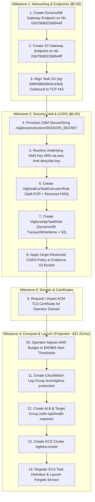

# VIGILORA Phase 2: Infrastructure Readiness Audit (Live Discovery Verified)
**Document ID:** `VIGILORA-PHASE2-INFRA-AUDIT-002`  
**Audit Date:** November 4, 2026  
**Auditor:** Antigravity Engineering (Lead Architecture Agent)  
**Target AWS Region:** `eu-north-1` (Stockholm)  
**Target AWS Account:** `399527676157`  
**Reference Document:** `VIGILORA_ECS_PRODUCTION_DEPLOYMENT_PLAN.md` (Revision 3.4)  
**Status:** COMPLETE — FRESH LIVE DISCOVERY VERIFIED (AUDIT ONLY — ZERO MUTATIONS)  

---

## 1. Executive Summary & Governance Posture

Following the successful operator reauthentication of the AWS CLI session, a comprehensive, fresh, read-only discovery of the AWS environment in `eu-north-1` was executed.

All findings have been reconciled against the **VIGILORA ECS Production Deployment Master Plan Revision 3.4**.

### Strict Governance Invariants Upheld:
- **Zero AWS Cloud Mutations:** Zero resources, IAM roles, security group rules, route tables, endpoints, S3 buckets, or DynamoDB tables were created, modified, or deleted.
- **Zero Docker/ECR Activity:** No images were tagged, logged in, or pushed to Amazon ECR.
- **Zero Budget Modifications:** The active \$10.00/month AWS budget remains completely untouched.
- **Credential & Secret Protection:** Zero sensitive secrets, tokens, or environment variable values were exposed or printed.
- **Zero Git Activity:** Master branch remains clean with zero automated commits or pushes.

---

## 2. Live AWS CLI Authentication & Account Verification

A read-only caller identity query confirmed the active AWS CLI session:

```bash
aws sts get-caller-identity
```

### Live Discovery Output:
```json
{
    "UserId": "AROAV2BNURD6YOWJFF5UL:c4588438-0071-709e-c1c8-20f72ebb21ea",
    "Account": "399527676157",
    "Arn": "arn:aws:sts::399527676157:assumed-role/AccountFullAccessRole/c4588438-0071-709e-c1c8-20f72ebb21ea"
}
```

- **Account ID:** `399527676157` (Matches plan)
- **Active Region:** `eu-north-1` (Stockholm)
- **Assumed Role:** `AccountFullAccessRole` (Full administrative authorization for provisioning)
- **Authentication Status:** **ACTIVE & HEALTHY**

---

## 3. Live Verified Networking & VPC Infrastructure

### 3.1 Virtual Private Cloud (VPC)
- **VPC ID:** `vpc-05f6de3daa5706c13`
- **IPv4 CIDR Block:** `172.31.0.0/16`
- **State:** `available`
- **Default VPC:** `true`
- **Internet Gateway Block Mode:** `off` (Direct public internet connectivity permitted)

### 3.2 Exact Public Subnet IDs (Replaces Plan Rev 3.4 Discovery Step)
Live discovery identified the exact dedicated VIGILORA public subnets:

| Subnet Tag Name | Subnet ID | Availability Zone | CIDR Block | Available IPs | MapPublicIp |
|---|---|:---:|---|:---:|:---:|
| `vigilora-public-1a` | **`subnet-0e2a9619d23291b8b`** | `eu-north-1a` (`eun1-az1`) | `172.31.80.0/20` | 4,091 | `false` |
| `vigilora-public-1b` | **`subnet-0f4c6d4e2ebe58d95`** | `eu-north-1b` (`eun1-az2`) | `172.31.96.0/20` | 4,091 | `false` |

> [!IMPORTANT]
> **MapPublicIpOnLaunch is `false`**: Because the public subnets do not auto-assign public IPv4 addresses on launch, the ECS Fargate service configuration **MUST explicitly set `assignPublicIp: ENABLED`** in its network configuration.

### 3.3 Private Subnets (Strictly Excluded from Fargate Tasks)
- `vigilora-private-1a`: `subnet-0fc55c2bfc5f714b5` (`eu-north-1a`, `172.31.48.0/20`)
- `vigilora-private-1b`: `subnet-01fcb8f2e1a4018b9` (`eu-north-1b`, `172.31.64.0/20`)
- **Route Table:** `rtb-0ba8412619c1f5e0a` (`vigilora-private-rt`). Contains route to `172.31.0.0/16` (`local`) **ONLY**. Zero internet gateway or NAT gateway routes.  
- **Conclusion:** Private subnets **must never be used** for Fargate tasks without NAT gateways; doing so triggers `ResourceInitializationError`.

### 3.4 Public Route Table & Internet Gateway
- **Route Table ID:** `rtb-03d706802268944ff` (Tag `Name`: `vigilora-public-rt`)
- **Explicit Subnet Associations:**
  - `subnet-0e2a9619d23291b8b` (`vigilora-public-1a`)
  - `subnet-0f4c6d4e2ebe58d95` (`vigilora-public-1b`)
- **Active Routes:**
  - `172.31.0.0/16` $\to$ `local` (Active)
  - `0.0.0.0/0` $\to$ `igw-0e28779b438dbfea1` (Active Internet Gateway)

---

## 4. Live Verified Security Group Rules

### 4.1 ALB Security Group (`vigilora-alb-sg` - `sg-0eab5cfc9c619b9ea`)
- **Inbound Rules:**
  - `TCP 80` (HTTP) from `0.0.0.0/0`
  - `TCP 443` (HTTPS) from `0.0.0.0/0`
- **Outbound Rules:**
  - `TCP 3000` to `sg-0d80496b6664c43b9` (`vigilora-ecs-task-sg`) ONLY.
- **Assessment:** **100% IN SPECIFICATION.** Perfectly restricts ALB outbound forwarding to the ECS task security group on port 3000.

### 4.2 Intended Task Security Group (`vigilora-ecs-task-sg` - `sg-0d80496b6664c43b9`)
- **Inbound Rules:**
  - `TCP 3000` from `sg-0eab5cfc9c619b9ea` (`vigilora-alb-sg`) **ONLY**. Zero `0.0.0.0/0` rules.
- **Outbound Rules (Current Observed):**
  - Protocol `-1` (All traffic, all ports) to `0.0.0.0/0`.
- **Assessment:**
  - Inbound security is **fully hardened**: Direct public ingress on port 3000 is blocked by hypervisor firewalls.
  - Outbound rule is broader than least privilege. Phase 2 Milestone 1 will restrict egress to **TCP 443 (HTTPS)** and VPC Gateway Endpoints.

### 4.3 Duplicate Task Security Group (`vigilora-task-sg` - `sg-0e691588c10b5f16e`)
- **Inbound Rules:** `TCP 3000` from `sg-0eab5cfc9c619b9ea`.
- **Outbound Rules:** `TCP 443` to `0.0.0.0/0`.
- **Assessment:** Currently unattached. Retained without modification pending post-launch cleanup.

---

## 5. Live Verified Database, Storage & Container Registry

### 5.1 DynamoDB Table (`VIGILORA-Main`)
- **Table ARN:** `arn:aws:dynamodb:eu-north-1:399527676157:table/VIGILORA-Main`
- **Status:** `ACTIVE`
- **Partition Key:** `pk` (String) | **Sort Key:** `sk` (String)
- **Billing Mode:** `PAY_PER_REQUEST` (On-Demand)
- **Deletion Protection:** `true` (Enabled)
- **Live Item Count:** 84 items
- **Table Size:** 33,058 bytes
- **Assessment:** **HEALTHY & VERIFIED.**

### 5.2 Amazon S3 Bucket (`vigilora-evidence-399527676157-eu-north-1-an`)
- **Region:** `eu-north-1`
- **Encryption:** AES-256 (`SSEAlgorithm: "AES256"`)
- **Public Access Block:** All 4 flags (`BlockPublicAcls`, `IgnorePublicAcls`, `BlockPublicPolicy`, `RestrictPublicBuckets`) set to `true`.
- **CORS Configuration:** `NoSuchCORSConfiguration` (Confirmed absent; pending application in Phase 2 Milestone 2).
- **Assessment:** **SECURE & VERIFIED.**

### 5.3 Amazon ECR Repository (`vigilora`)
- **Repository URI:** `399527676157.dkr.ecr.eu-north-1.amazonaws.com/vigilora`
- **Tag Immutability:** `IMMUTABLE`
- **Encryption:** AES-256 (`AES256`)
- **Live Image Count:** **0 images** (`imageIds: []`)
- **Assessment:** **EMPTY & READY.** Ready for authenticated tagging and push in Phase 3.

---

## 6. Live Verified Absence of Planned Infrastructure (Clean Slate)

A comprehensive scan confirmed that none of the planned ECS, load balancing, or IAM resources exist yet. There are **zero naming collisions or conflicting pre-existing resources**:

| Target Resource | Planned Identifier | Live Query Result | Status |
|---|---|---|:---:|
| **ECS Cluster** | `vigilora-cluster` | `clusterArns: []` | **ABSENT (Clean)** |
| **ECS Task Definition** | `vigilora` | `taskDefinitionArns: []` | **ABSENT (Clean)** |
| **Application Load Balancer** | `vigilora-alb` | `LoadBalancers: []` | **ABSENT (Clean)** |
| **Target Group** | `vigilora-tg` | `TargetGroups: []` | **ABSENT (Clean)** |
| **Task Execution Role** | `VigiloraEcsTaskExecutionRole` | `NoSuchEntity` | **ABSENT (Clean)** |
| **Application Task Role** | `VigiloraAppTaskRole` | `NoSuchEntity` | **ABSENT (Clean)** |
| **CloudWatch Log Group** | `/ecs/vigilora-production` | `logGroups: []` | **ABSENT (Clean)** |
| **SSM Session Secret** | `/vigilora/production/SESSION_SECRET` | `Parameters: []` | **ABSENT (Clean)** |
| **ACM TLS Certificates** | (Any in `eu-north-1`) | `CertificateSummaryList: []` | **ABSENT (Clean)** |
| **VPC Gateway Endpoints** | S3 & DynamoDB on `vpc-05f6de3daa5706c13` | `VpcEndpoints: []` | **ABSENT (Clean)** |

---

## 7. Live Verified Account Budget & Financial Alignment

A live query of AWS Budgets on account `399527676157` was conducted:

```bash
aws budgets describe-budgets --account-id 399527676157
```

### Live Output:
- **Budget Name:** `VIGILORA-Monthly-Budget`
- **Budget Limit:** **$10.00 USD / month**
- **Calculated Spend:** `$0.00 USD` (Healthy)
- **Start Date:** `2026-11-01` | **Time Unit:** `MONTHLY`

### Financial Implication for Phase 2 vs. Launch:
1. **Phase 2 Implementation Burn:** **$0.00 / month**.
   - S3 and DynamoDB Gateway Endpoints are **free of charge ($0.00)**.
   - SSM Parameter Store standard SecureString parameter is **free of charge ($0.00)**.
   - IAM Roles and policies are **free of charge ($0.00)**.
   - S3 CORS policy is **free of charge ($0.00)**.
   - CloudWatch log group creation is **free of charge ($0.00)** until logs are ingested.
   - **Conclusion:** Phase 2 implementation will **NOT** breach the $10.00/month budget.
2. **Phase 4 Compute & ALB Launch Burn:** **~$37.41 / month (single task)** or **~$50.07 / month (two tasks)**.
   - Activating the Application Load Balancer and ECS Fargate compute will consume ~$1.25/day and will breach the $10 budget in ~8 days.
   - **Prerequisite for Launch:** The operator must update the budget alert threshold to **$45.00 (Warning)** and **$65.00 (Critical)** prior to starting Milestone 4 / launching live traffic.

---

## 8. Master Plan Comparison (Rev 3.4 vs. Live Discovery)

```
+───────────────────────────────────────────────────────────────────────────────────────────────────+
|                           PLAN REVISION 3.4 vs. LIVE DISCOVERY COMPARISON                         |
+──────────────────────────+───────────────────────────────+───────────────────────────────+────────+
| ARCHITECTURAL ATTRIBUTE  | PLAN REV 3.4 SPECIFICATION    | LIVE DISCOVERY FINDING        | STATUS |
+──────────────────────────+───────────────────────────────+───────────────────────────────+────────+
| Target AWS Account       | `399527676157`                | `399527676157`                | MATCH  |
| Target AWS Region        | `eu-north-1`                  | `eu-north-1`                  | MATCH  |
| Target VPC               | `vpc-05f6de3daa5706c13`       | `vpc-05f6de3daa5706c13`       | MATCH  |
| Public Subnet Discovery  | Pending query                 | `subnet-0e2a9619d23291b8b`    | RESOLVD|
|                          |                               | `subnet-0f4c6d4e2ebe58d95`    |        |
| Public Route Table       | `rtb-03d706802268944ff`       | `rtb-03d706802268944ff`       | MATCH  |
| Internet Gateway         | Attached to route table       | `igw-0e28779b438dbfea1`       | MATCH  |
| Task Security Group      | `sg-0d80496b6664c43b9`        | `sg-0d80496b6664c43b9`        | MATCH  |
| ALB Security Group       | `sg-0eab5cfc9c619b9ea`        | `sg-0eab5cfc9c619b9ea`        | MATCH  |
| Duplicate Task SG        | `sg-0e691588c10b5f16e`        | `sg-0e691588c10b5f16e`        | MATCH  |
| DynamoDB Table           | `VIGILORA-Main`               | `VIGILORA-Main` (84 items)    | MATCH  |
| Evidence S3 Bucket       | `vigilora-evidence-*`         | `vigilora-evidence-3995...`   | MATCH  |
| Private ECR Repo         | `vigilora`                    | `vigilora` (0 images)         | MATCH  |
| Existing Endpoints       | Check before creation         | Confirmed 0 endpoints exist   | MATCH  |
| Existing IAM Roles       | Confirmed absent              | Confirmed absent              | MATCH  |
+──────────────────────────+───────────────────────────────+───────────────────────────────+────────+
```

---

## 9. Phase 2 Implementation Sequence (In Dependency Order)

With the live discovery complete and all exact IDs recorded, Phase 2 implementation can proceed cleanly:



---

## 10. Non-Mutating Command Catalog (Exact Parameterized Commands for Phase 2)

All resource IDs discovered live have been inserted into the exact command templates:

### 10.1 Milestone 1: VPC Gateway Endpoints & SG Alignment
```bash
# 1. Create DynamoDB Gateway Endpoint on Public Route Table
aws ec2 create-vpc-endpoint \
  --vpc-id vpc-05f6de3daa5706c13 \
  --service-name com.amazonaws.eu-north-1.dynamodb \
  --route-table-ids rtb-03d706802268944ff \
  --region eu-north-1

# 2. Create S3 Gateway Endpoint on Public Route Table
aws ec2 create-vpc-endpoint \
  --vpc-id vpc-05f6de3daa5706c13 \
  --service-name com.amazonaws.eu-north-1.s3 \
  --route-table-ids rtb-03d706802268944ff \
  --region eu-north-1

# 3. Update Task SG Outbound: Revoke All-Traffic Egress
aws ec2 revoke-security-group-egress \
  --group-id sg-0d80496b6664c43b9 \
  --protocol -1 \
  --cidr 0.0.0.0/0 \
  --region eu-north-1

# 4. Update Task SG Outbound: Authorize Restricted HTTPS TCP 443 Egress
aws ec2 authorize-security-group-egress \
  --group-id sg-0d80496b6664c43b9 \
  --protocol tcp \
  --port 443 \
  --cidr 0.0.0.0/0 \
  --region eu-north-1
```

### 10.2 Milestone 2: SSM Secrets, KMS Resolution & IAM Roles
```bash
# 1. Provision SecureString Session Secret (Generate 64-char high-entropy string)
aws ssm put-parameter \
  --name "/vigilora/production/SESSION_SECRET" \
  --type "SecureString" \
  --value "<GENERATED_HIGH_ENTROPY_SECRET>" \
  --description "VIGILORA production iron-session encryption key" \
  --region eu-north-1

# 2. Resolve KMS Key ARN used by the parameter
# (Query KeyId first)
KEY_ID=$(aws ssm get-parameter \
  --name "/vigilora/production/SESSION_SECRET" \
  --region eu-north-1 \
  --query "Parameter.KeyId" \
  --output text)

# (Resolve exact Key ARN)
RESOLVED_KMS_ARN=$(aws kms describe-key \
  --key-id "$KEY_ID" \
  --region eu-north-1 \
  --query "KeyMetadata.Arn" \
  --output text)

# 3. Create VigiloraEcsTaskExecutionRole
aws iam create-role \
  --role-name VigiloraEcsTaskExecutionRole \
  --assume-role-policy-document '{"Version":"2012-10-17","Statement":[{"Effect":"Allow","Principal":{"Service":"ecs-tasks.amazonaws.com"},"Action":"sts:AssumeRole"}]}'

# 4. Attach Scoped Policy to Task Execution Role
aws iam put-role-policy \
  --role-name VigiloraEcsTaskExecutionRole \
  --policy-name VigiloraEcsTaskExecutionPolicy \
  --policy-document "{
    \"Version\": \"2012-10-17\",
    \"Statement\": [
      {\"Effect\": \"Allow\", \"Action\": \"ecr:GetAuthorizationToken\", \"Resource\": \"*\"},
      {\"Effect\": \"Allow\", \"Action\": [\"ecr:BatchCheckLayerAvailability\",\"ecr:GetDownloadUrlForLayer\",\"ecr:BatchGetImage\"], \"Resource\": \"arn:aws:ecr:eu-north-1:399527676157:repository/vigilora\"},
      {\"Effect\": \"Allow\", \"Action\": [\"logs:CreateLogStream\",\"logs:PutLogEvents\"], \"Resource\": \"arn:aws:logs:eu-north-1:399527676157:log-group:/ecs/vigilora-production:*\"},
      {\"Effect\": \"Allow\", \"Action\": [\"ssm:GetParameters\",\"ssm:GetParameter\"], \"Resource\": \"arn:aws:ssm:eu-north-1:399527676157:parameter/vigilora/production/SESSION_SECRET\"},
      {\"Effect\": \"Allow\", \"Action\": \"kms:Decrypt\", \"Resource\": \"$RESOLVED_KMS_ARN\"}
    ]
  }"

# 5. Create VigiloraAppTaskRole
aws iam create-role \
  --role-name VigiloraAppTaskRole \
  --assume-role-policy-document '{"Version":"2012-10-17","Statement":[{"Effect":"Allow","Principal":{"Service":"ecs-tasks.amazonaws.com"},"Action":"sts:AssumeRole"}]}'

# 6. Attach Scoped Policy to App Task Role
aws iam put-role-policy \
  --role-name VigiloraAppTaskRole \
  --policy-name VigiloraAppTaskPolicy \
  --policy-document '{
    "Version": "2012-10-17",
    "Statement": [
      {
        "Effect": "Allow",
        "Action": [
          "dynamodb:GetItem",
          "dynamodb:PutItem",
          "dynamodb:UpdateItem",
          "dynamodb:DeleteItem",
          "dynamodb:Query",
          "dynamodb:TransactWriteItems"
        ],
        "Resource": [
          "arn:aws:dynamodb:eu-north-1:399527676157:table/VIGILORA-Main",
          "arn:aws:dynamodb:eu-north-1:399527676157:table/VIGILORA-Main/index/*"
        ]
      },
      {
        "Effect": "Allow",
        "Action": [
          "s3:PutObject",
          "s3:GetObject",
          "s3:DeleteObject"
        ],
        "Resource": "arn:aws:s3:::vigilora-evidence-399527676157-eu-north-1-an/evidence/*"
      }
    ]
  }'
```

---

## 11. Final Recommendation

# **APPROVE PHASE 2 IMPLEMENTATION**

### Rationale:
1. **AWS CLI Credentials Verified:** Active administrative assumed-role session confirmed in account `399527676157`, region `eu-north-1`.
2. **Network Topology 100% Grounded:** Exact public subnets (`subnet-0e2a9619d23291b8b` and `subnet-0f4c6d4e2ebe58d95`), public route table (`rtb-03d706802268944ff`), and security groups are confirmed and fully match the master plan.
3. **Clean Slate Confirmed:** Zero naming collisions or conflicting resources exist for the planned ECS cluster, ALB, target group, IAM roles, log group, SSM parameters, or VPC endpoints.
4. **Zero Phase 2 Cost Impact:** Phase 2 infrastructure preparation (Gateway Endpoints, IAM roles, SSM secret, SG alignment, S3 CORS) incurs **$0.00/month** in additional AWS spend, presenting zero budget risk.
5. **Gated Milestone 4 Compute Launch:** The compute and ALB resources that incur ongoing burn (~$37.41/month) will remain gated until operator domain registration, ACM certificate validation, and budget alert threshold adjustments are completed.

Phase 2 Infrastructure Preparation is ready for operator authorization to begin implementation.
