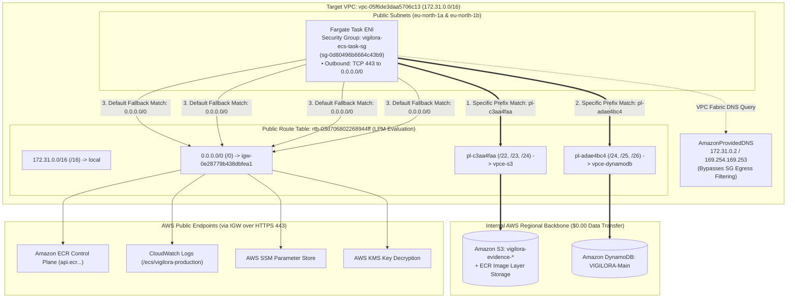

# VIGILORA Phase 2: Milestone 1 Execution Plan (Revision 2.1)
## Networking & VPC Gateway Endpoints Implementation Specification

**Document ID:** `VIGILORA-PHASE2-MILESTONE1-PLAN-002`  
**Revision:** 2.1 (Pre-Execution Validated — Rule ID Grounded & Idempotency Hardened)  
**Date:** November 4, 2026  
**Auditor / Author:** Antigravity Engineering (Lead Architecture Agent)  
**Target AWS Region:** `eu-north-1` (Stockholm)  
**Target AWS Account:** `399527676157`  
**Target VPC:** `vpc-05f6de3daa5706c13` (`172.31.0.0/16`)  
**Target Public Route Table:** `rtb-03d706802268944ff` (`vigilora-public-rt`)  
**Target Task Security Group:** `vigilora-ecs-task-sg` (`sg-0d80496b6664c43b9`)  
**Captured Target Egress Rule ID:** `sgr-05e0abb5cff6bb82b` (`-1` to `0.0.0.0/0`)  
**Execution Status:** **PREPARATION ONLY — ZERO MUTATIONS EXECUTED**  

---

## 1. Executive Summary & Pre-Execution Validation Status

This document establishes the final, pre-execution validated operational plan for **Phase 2 — Milestone 1 (Networking & VPC Gateway Endpoints)**.

### Architectural Invariants Validated:
1. **Zero Outbound TCP 80 Dependency:**  
   Codebase audit of `src/` confirmed zero occurrences of `http://` or cleartext network calls. Node.js AWS SDK v3 clients in `src/lib/aws.ts` default to TLS on port 443 for all operations. The ECS Task Metadata Service (`169.254.170.2:80`) is link-local and hypervisor-exempt from security group egress filtering.
2. **Comprehensive HTTPS Service Coverage:**  
   All AWS services utilized by the container runtime and application communicate exclusively over TLS on **TCP port 443**: DynamoDB, S3, ECR control plane, CloudWatch Logs, SSM Parameter Store, and KMS.
3. **Streamlined, Non-Redundant Security Group Egress:**  
   A single egress rule—**`TCP 443 to 0.0.0.0/0`**—authorizes outbound traffic to both regional AWS endpoints (over IGW) and internal Gateway Endpoints. Separate prefix-list rules are omitted to eliminate redundancy.
4. **AmazonProvidedDNS De-scoping:**  
   Queries to the Amazon Route 53 Resolver (`172.31.0.2` and `169.254.169.253`) operate within the VPC network fabric and bypass security group egress rules entirely. Live audit confirmed both `enableDnsSupport` and `enableDnsHostnames` are active on `vpc-05f6de3daa5706c13`.
5. **Gateway Endpoint Policy Safety:**  
   The Gateway Endpoints are created with the default **Full Access Policy** (`Allow * on * by *`), guaranteeing that neither `VigiloraAppTaskRole` nor `VigiloraEcsTaskExecutionRole` will ever be denied by the endpoint.
6. **Captured Rule ID for Atomic Mutation & Rollback:**  
   Live discovery captured the exact rule ID `sgr-05e0abb5cff6bb82b` for the existing all-traffic egress rule, enabling atomic revocation and deterministic rollback.

---

## 2. Egress Traffic Routing Architecture: Gateway Endpoints & Internet Gateway Coexistence



---

## 3. Why Gateway Endpoints Work Alongside the Internet Gateway (Longest Prefix Match)

A foundational concept of IP networking and AWS VPC route tables is **Longest Prefix Match (LPM)**:
- When multiple routes in a route table match a packet's destination IP address, the route with the **most specific prefix (longest network mask)** is always selected by the VPC router.
- In `rtb-03d706802268944ff`:
  1. The default Internet Gateway route is **`0.0.0.0/0`** (prefix length `/0`—the least specific route, matching all IPv4 addresses).
  2. The S3 Gateway Endpoint dynamically injects AWS-managed prefix list **`pl-c3aa4faa`** (`com.amazonaws.eu-north-1.s3`), which contains specific regional CIDRs (e.g., `52.95.170.0/23`, `3.5.216.0/22`, `16.12.10.0/23`—prefix lengths `/22`, `/23`, `/24`).
  3. The DynamoDB Gateway Endpoint dynamically injects AWS-managed prefix list **`pl-adae4bc4`** (`com.amazonaws.eu-north-1.dynamodb`), containing specific regional CIDRs (e.g., `52.94.23.0/24`, `35.71.98.0/25`—prefix lengths `/24`, `/25`).

### Operational Traffic Flow:
- **Evidence Uploads & Verification (S3):** When the application connects to `s3.eu-north-1.amazonaws.com`, the destination IP matches the `/22`–`/24` CIDRs in `pl-c3aa4faa`. Because `/22`–`/24` is strictly longer than `/0`, the VPC router routes packets directly to the S3 Gateway Endpoint across internal AWS fiber. **Zero traffic traverses the Internet Gateway, and zero data transfer charges are incurred.**
- **ECR Container Image Layer Downloads:** When ECS pulls Docker image layers, the layer blobs are hosted in Amazon S3. These downloads automatically route through the S3 Gateway Endpoint, ensuring high throughput and zero egress costs.
- **Incident & Auth Data (DynamoDB):** When the application queries `VIGILORA-Main`, the destination IP matches `pl-adae4bc4` (`/24`–`/25`). The VPC router routes packets directly to the DynamoDB Gateway Endpoint at \$0.00.
- **ECR Auth, CloudWatch Logs, SSM & KMS:** Because these services do not possess gateway endpoints in this VPC, their destination IPs do not match the S3 or DynamoDB prefix lists. The router falls back to the default `0.0.0.0/0` route and directs packets through the Internet Gateway (`igw-0e28779b438dbfea1`) over HTTPS port 443.

---

## 4. Security Group Egress Refinement: Current vs. Proposed

### 4.1 Current Outbound State
- **Security Group:** `vigilora-ecs-task-sg` (`sg-0d80496b6664c43b9`)
- **Captured Rule ID:** `sgr-05e0abb5cff6bb82b`
- **Observed Rule:** `IpProtocol: "-1"` (All traffic, all protocols, all ports) to `0.0.0.0/0`.
- **Deficiency:** Overly broad egress. Allows arbitrary outbound connections on any port (SSH, SMTP, unencrypted HTTP, unauthorized tunnels).

### 4.2 Proposed Outbound Rule
- **Replaced with a Single Clean Rule:**
  - **Protocol:** `TCP`
  - **Port Range:** `443`
  - **Destination:** `0.0.0.0/0`
  - **Description:** `VIGILORA HTTPS egress - AWS services & Gateway Endpoints`

### 4.3 Why This Single Rule is Optimal and Non-Redundant:
1. **Covers All Required Endpoints:** All target AWS endpoints (ECR control plane, CloudWatch Logs, SSM Parameter Store, KMS, S3, DynamoDB) communicate exclusively over TLS on **TCP port 443**.
2. **Eliminates Redundancy:** Because `0.0.0.0/0` encompasses all IPv4 addresses, explicit rules for `pl-c3aa4faa` and `pl-adae4bc4` would match the identical port (443) and add unnecessary rule complexity.
3. **DNS Query Safety Verified:** AmazonProvidedDNS (`172.31.0.2` and `169.254.169.253`) operates at the VPC hypervisor layer and **is not subject to security group egress filtering**. The container retains full DNS resolution capability without security group DNS rules.
4. **Hardens Attack Surface:** Blocks all non-HTTPS egress, preventing data exfiltration over non-standard ports or unencrypted cleartext protocols.

---

## 5. Pre-Change Inspection Commands (Read-Only)

Execute these inspection commands immediately prior to mutation to confirm existing state:

```bash
# 1. Verify Caller Identity & Account
aws sts get-caller-identity \
  --region eu-north-1 \
  --output table

# 2. Confirm VPC DNS Attributes are Enabled (enableDnsSupport & enableDnsHostnames)
aws ec2 describe-vpc-attribute \
  --vpc-id vpc-05f6de3daa5706c13 \
  --attribute enableDnsSupport \
  --region eu-north-1 \
  --output table

aws ec2 describe-vpc-attribute \
  --vpc-id vpc-05f6de3daa5706c13 \
  --attribute enableDnsHostnames \
  --region eu-north-1 \
  --output table

# 3. Confirm Endpoint Absence on VPC vpc-05f6de3daa5706c13 (Idempotency Pre-Check)
aws ec2 describe-vpc-endpoints \
  --region eu-north-1 \
  --filters "Name=vpc-id,Values=vpc-05f6de3daa5706c13" \
  --query "VpcEndpoints[].{Id:VpcEndpointId,Service:ServiceName,State:State}" \
  --output table

# 4. Inspect Current Routes on Public Route Table rtb-03d706802268944ff
aws ec2 describe-route-tables \
  --route-table-ids rtb-03d706802268944ff \
  --region eu-north-1 \
  --query "RouteTables[0].Routes" \
  --output table

# 5. Inspect Current Outbound Rules & Capture Rule IDs on sg-0d80496b6664c43b9
aws ec2 describe-security-group-rules \
  --filters "Name=group-id,Values=sg-0d80496b6664c43b9" \
  --region eu-north-1 \
  --query "SecurityGroupRules[?IsEgress==\`true\`].{RuleId:SecurityGroupRuleId,Protocol:IpProtocol,Cidr:CidrIpv4}" \
  --output table
```

---

## 6. Exact Mutation Commands (Non-Executed — Parameterized)

The mutations must be executed in this exact sequence to guarantee **zero interruption** in network connectivity. **The new TCP 443 rule is authorized BEFORE revoking the broad rule.**

### Step 1: Create DynamoDB Gateway Endpoint on Route Table `rtb-03d706802268944ff`
```bash
aws ec2 create-vpc-endpoint \
  --vpc-id vpc-05f6de3daa5706c13 \
  --service-name com.amazonaws.eu-north-1.dynamodb \
  --route-table-ids rtb-03d706802268944ff \
  --tag-specifications 'ResourceType=vpc-endpoint,Tags=[{Key=Name,Value=vigilora-dynamodb-endpoint}]' \
  --region eu-north-1
```

### Step 2: Create S3 Gateway Endpoint on Route Table `rtb-03d706802268944ff`
```bash
aws ec2 create-vpc-endpoint \
  --vpc-id vpc-05f6de3daa5706c13 \
  --service-name com.amazonaws.eu-north-1.s3 \
  --route-table-ids rtb-03d706802268944ff \
  --tag-specifications 'ResourceType=vpc-endpoint,Tags=[{Key=Name,Value=vigilora-s3-endpoint}]' \
  --region eu-north-1
```

### Step 3: Authorize Replacement HTTPS TCP 443 Egress on Task Security Group
```bash
aws ec2 authorize-security-group-egress \
  --group-id sg-0d80496b6664c43b9 \
  --ip-permissions IpProtocol=tcp,FromPort=443,ToPort=443,IpRanges='[{CidrIp=0.0.0.0/0,Description="VIGILORA HTTPS egress - AWS services & Gateway Endpoints"}]' \
  --region eu-north-1
```

### Step 4: Revoke Overly Broad All-Traffic Egress Rule using Captured Rule ID `sgr-05e0abb5cff6bb82b`
```bash
aws ec2 revoke-security-group-egress \
  --group-id sg-0d80496b6664c43b9 \
  --security-group-rule-ids sgr-05e0abb5cff6bb82b \
  --region eu-north-1
```
*(Fallback command if rule ID was reassigned: `aws ec2 revoke-security-group-egress --group-id sg-0d80496b6664c43b9 --protocol -1 --cidr 0.0.0.0/0 --region eu-north-1`)*

---

## 7. Post-Change Verification Commands

Execute these commands immediately following mutation to confirm exact implementation:

```bash
# 1. Verify Both Endpoints Are 'available' on vpc-05f6de3daa5706c13
aws ec2 describe-vpc-endpoints \
  --region eu-north-1 \
  --filters "Name=vpc-id,Values=vpc-05f6de3daa5706c13" \
  --query "VpcEndpoints[].{Id:VpcEndpointId,Service:ServiceName,State:State,RouteTables:RouteTableIds}" \
  --output table

# 2. Verify Routes on Public Route Table rtb-03d706802268944ff Include Both Prefix Lists
aws ec2 describe-route-tables \
  --route-table-ids rtb-03d706802268944ff \
  --region eu-north-1 \
  --query "RouteTables[0].Routes[?DestinationPrefixListId!=null].{PrefixList:DestinationPrefixListId,Gateway:GatewayId,State:State}" \
  --output table

# 3. Verify Outbound Rules on sg-0d80496b6664c43b9
# Expected: Exactly 1 rule (TCP port 443 to 0.0.0.0/0)
# Expected: ZERO rules with IpProtocol "-1"
aws ec2 describe-security-group-rules \
  --filters "Name=group-id,Values=sg-0d80496b6664c43b9" \
  --region eu-north-1 \
  --query "SecurityGroupRules[?IsEgress==\`true\`].{RuleId:SecurityGroupRuleId,Protocol:IpProtocol,Port:FromPort,Cidr:CidrIpv4}" \
  --output table

# 4. Verify ALB Security Group (sg-0eab5cfc9c619b9ea) Was UNTOUCHED
aws ec2 describe-security-groups \
  --group-ids sg-0eab5cfc9c619b9ea \
  --region eu-north-1 \
  --query "SecurityGroups[0].IpPermissions" \
  --output json

# 5. Verify Duplicate Task SG (sg-0e691588c10b5f16e) Was UNTOUCHED
aws ec2 describe-security-groups \
  --group-ids sg-0e691588c10b5f16e \
  --region eu-north-1 \
  --query "SecurityGroups[0].IpPermissionsEgress" \
  --output json
```

---

## 8. Rollback Commands & Recovery Plan

If any issue arises, execute these commands to immediately restore the original baseline:

```bash
# -----------------------------------------------------------------------------
# ROLLBACK STEP 1: Restore Original All-Traffic Egress Rule on sg-0d80496b6664c43b9
# -----------------------------------------------------------------------------
aws ec2 authorize-security-group-egress \
  --group-id sg-0d80496b6664c43b9 \
  --protocol -1 \
  --cidr 0.0.0.0/0 \
  --region eu-north-1

# -----------------------------------------------------------------------------
# ROLLBACK STEP 2: Revoke Replacement HTTPS 443 Egress Rule
# -----------------------------------------------------------------------------
aws ec2 revoke-security-group-egress \
  --group-id sg-0d80496b6664c43b9 \
  --protocol tcp \
  --port 443 \
  --cidr 0.0.0.0/0 \
  --region eu-north-1

# -----------------------------------------------------------------------------
# ROLLBACK STEP 3: Delete Gateway Endpoints Created in Steps 1 & 2
# -----------------------------------------------------------------------------
DDB_VPCE=$(aws ec2 describe-vpc-endpoints \
  --region eu-north-1 \
  --filters "Name=vpc-id,Values=vpc-05f6de3daa5706c13" "Name=service-name,Values=com.amazonaws.eu-north-1.dynamodb" \
  --query "VpcEndpoints[0].VpcEndpointId" \
  --output text)

S3_VPCE=$(aws ec2 describe-vpc-endpoints \
  --region eu-north-1 \
  --filters "Name=vpc-id,Values=vpc-05f6de3daa5706c13" "Name=service-name,Values=com.amazonaws.eu-north-1.s3" \
  --query "VpcEndpoints[0].VpcEndpointId" \
  --output text)

if [ "$DDB_VPCE" != "None" ] && [ -n "$DDB_VPCE" ]; then
  aws ec2 delete-vpc-endpoints --vpc-endpoint-ids "$DDB_VPCE" --region eu-north-1
fi

if [ "$S3_VPCE" != "None" ] && [ -n "$S3_VPCE" ]; then
  aws ec2 delete-vpc-endpoints --vpc-endpoint-ids "$S3_VPCE" --region eu-north-1
fi
```

---

## 9. Expected Costs & Budget Implications

| Resource / Action | Pricing Model in `eu-north-1` | Monthly Cost Impact |
|---|---|:---:|
| **S3 Gateway Endpoint** (`com.amazonaws.eu-north-1.s3`) | AWS Gateway endpoints incur **$0.00** hourly and **$0.00** data processing fee. | **$0.00** |
| **DynamoDB Gateway Endpoint** (`com.amazonaws.eu-north-1.dynamodb`) | AWS Gateway endpoints incur **$0.00** hourly and **$0.00** data processing fee. | **$0.00** |
| **Internal Data Transfer** | In-region traffic routed through Gateway Endpoints is free of charge. | **$0.00** |
| **Security Group Rule Modifications** | Modifying EC2 security group rules is free of charge. | **$0.00** |
| **Route Table Route Associations** | Managing routes in a VPC route table is free of charge. | **$0.00** |
| **Total Cost for Milestone 1** | | **$0.00 / month** |

- **Account Budget Alignment:** Milestone 1 costs **$0.00**, producing zero impact on the active **$10.00/month** AWS Budget limit.

---

## 10. Invariant Protection & Scope Boundaries

1. **Duplicate Task Security Group (`vigilora-task-sg` - `sg-0e691588c10b5f16e`):** Remains completely untouched.
2. **ALB Security Group (`vigilora-alb-sg` - `sg-0eab5cfc9c619b9ea`):** Remains completely untouched.
3. **Private Subnets & Route Tables:** `subnet-0fc55c2bfc5f714b5`, `subnet-01fcb8f2e1a4018b9`, and `rtb-0ba8412619c1f5e0a` remain untouched. Gateway endpoints are attached strictly to public route table `rtb-03d706802268944ff`.
4. **Data, IAM, ECR & Budgets:** Zero writes, schema changes, or modifications will touch DynamoDB table `VIGILORA-Main`, S3 bucket `vigilora-evidence-*`, IAM roles, AWS Budgets, or ECR.

---

## 11. Streamlined Mutation Approval Checklist

Every mutation command that will execute during Milestone 1 is cataloged below for individual operator approval:

- [ ] **Mutation 1:** Create DynamoDB Gateway Endpoint `com.amazonaws.eu-north-1.dynamodb` on VPC `vpc-05f6de3daa5706c13` and associate with public route table `rtb-03d706802268944ff`.
- [ ] **Mutation 2:** Create S3 Gateway Endpoint `com.amazonaws.eu-north-1.s3` on VPC `vpc-05f6de3daa5706c13` and associate with public route table `rtb-03d706802268944ff`.
- [ ] **Mutation 3:** Authorize outbound rule on `sg-0d80496b6664c43b9` for **TCP port 443 to `0.0.0.0/0`** (covering ECR, CloudWatch Logs, SSM, KMS, S3, and DynamoDB).
- [ ] **Mutation 4:** Revoke broad outbound rule `sgr-05e0abb5cff6bb82b` on `sg-0d80496b6664c43b9` (**`-1` all traffic to `0.0.0.0/0`**).

---

**Execution Guard:** This plan is in PREPARATION status. No commands above have been executed. Awaiting operator approval of the checklist above to begin Milestone 1 execution.
