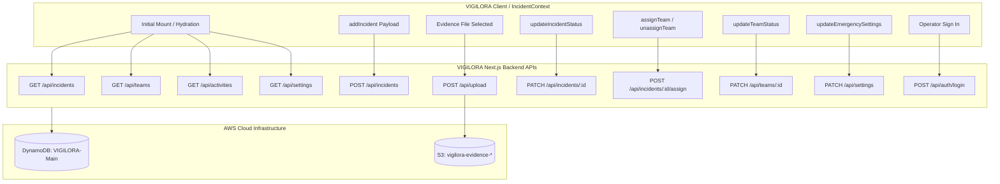
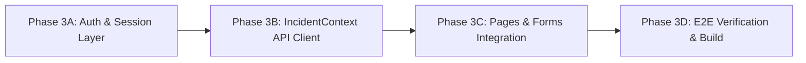

# VIGILORA Frontend Integration Plan & Readiness Audit (Phase 3)

**Document Version:** 1.0.0  
**Status:** Audit Complete & Planned — Awaiting Implementation Approval  
**Target:** VIGILORA Frontend Integration with AWS DynamoDB (`VIGILORA-Main`) and AWS S3 (`vigilora-evidence-399527676157-eu-north-1-an`)  

---

## Executive Summary

This document presents a comprehensive integration mapping and readiness audit of the VIGILORA frontend codebase prior to Phase 3 implementation. It evaluates all existing client-side state storage, identifies every `localStorage` read and write, specifies the exact AWS backend APIs replacing them, maps request/response data contracts, establishes authentication and session handling, defines error/loading/empty/unauthorized states, and resolves all frontend-backend architectural gaps without altering the established Gothic UI, layout, animations, or styling.

---

## 1. Inventory of Every `localStorage` Read and Write

Currently, all client persistence is located exclusively within [`src/context/IncidentContext.tsx`](file:///c:/Users/testp/Desktop/PROJECTS/VIGILORA/src/context/IncidentContext.tsx), with narrative references in [`src/app/settings/page.tsx`](file:///c:/Users/testp/Desktop/PROJECTS/VIGILORA/src/app/settings/page.tsx).

### Storage Keys
```typescript
const STORAGE_KEYS = {
  INCIDENTS: "vigilora_demo_incidents_v2",
  TEAMS: "vigilora_demo_teams_v2",
  ACTIVITIES: "vigilora_demo_activities_v2",
  SETTINGS: "vigilora_demo_emergency_settings_v2",
};
```

### Complete Read Operations
| Location | Key | Trigger | Target State | Fallback Behavior on Miss |
| :--- | :--- | :--- | :--- | :--- |
| `IncidentContext.tsx:110` | `STORAGE_KEYS.INCIDENTS` | Mount `useEffect` | `incidents` | Seeds `DEMO_INCIDENTS` to localStorage |
| `IncidentContext.tsx:111` | `STORAGE_KEYS.TEAMS` | Mount `useEffect` | `teams` | Seeds `DEMO_TEAMS` to localStorage |
| `IncidentContext.tsx:112` | `STORAGE_KEYS.ACTIVITIES` | Mount `useEffect` | `activities` | Seeds `DEMO_ACTIVITIES` to localStorage |
| `IncidentContext.tsx:113` | `STORAGE_KEYS.SETTINGS` | Mount `useEffect` | `emergencySettings` | Seeds `DEFAULT_SETTINGS` to localStorage |

### Complete Write Operations
| Location | Key | Trigger | Written Data Payload |
| :--- | :--- | :--- | :--- |
| `IncidentContext.tsx:118` | `STORAGE_KEYS.INCIDENTS` | Initial mount fallback | `JSON.stringify(DEMO_INCIDENTS)` |
| `IncidentContext.tsx:124` | `STORAGE_KEYS.TEAMS` | Initial mount fallback | `JSON.stringify(DEMO_TEAMS)` |
| `IncidentContext.tsx:130` | `STORAGE_KEYS.ACTIVITIES` | Initial mount fallback | `JSON.stringify(DEMO_ACTIVITIES)` |
| `IncidentContext.tsx:136` | `STORAGE_KEYS.SETTINGS` | Initial mount fallback | `JSON.stringify(DEFAULT_SETTINGS)` |
| `IncidentContext.tsx:149` | `STORAGE_KEYS.INCIDENTS` | `incidents` state change | `JSON.stringify(incidents)` |
| `IncidentContext.tsx:158` | `STORAGE_KEYS.TEAMS` | `teams` state change | `JSON.stringify(teams)` |
| `IncidentContext.tsx:167` | `STORAGE_KEYS.ACTIVITIES` | `activities` state change | `JSON.stringify(activities)` |
| `IncidentContext.tsx:176` | `STORAGE_KEYS.SETTINGS` | `emergencySettings` state change | `JSON.stringify(emergencySettings)` |

### Complete Deletion Operations
| Location | Key | Trigger | Purpose |
| :--- | :--- | :--- | :--- |
| `IncidentContext.tsx:468` | `STORAGE_KEYS.INCIDENTS` | `resetDemoData()` called | Reset demonstration incidents |
| `IncidentContext.tsx:469` | `STORAGE_KEYS.TEAMS` | `resetDemoData()` called | Reset demonstration teams |
| `IncidentContext.tsx:470` | `STORAGE_KEYS.ACTIVITIES` | `resetDemoData()` called | Reset demonstration activity logs |
| `IncidentContext.tsx:471` | `STORAGE_KEYS.SETTINGS` | `resetDemoData()` called | Reset demonstration settings |

---

## 2. Backend API Replacements for Every Frontend Operation

Every client-side memory/localStorage operation has an exact serverless AWS API counterpart built and verified in Milestones 1–5:



### Operation Mapping Table
| Frontend Function / Trigger | Current Implementation | Target Backend API | Target AWS Resource |
| :--- | :--- | :--- | :--- |
| Initial incident hydration | Read `STORAGE_KEYS.INCIDENTS` | `GET /api/incidents` | DynamoDB `pk: CAMPUS#<id>`, `sk: INCIDENT#*` |
| Initial teams hydration | Read `STORAGE_KEYS.TEAMS` | `GET /api/teams` | DynamoDB `pk: CAMPUS#<id>`, `sk: TEAM#*` |
| Initial activities hydration | Read `STORAGE_KEYS.ACTIVITIES` | `GET /api/activities` | DynamoDB `pk: CAMPUS#<id>`, `sk: ACTIVITY#*` |
| Initial settings hydration | Read `STORAGE_KEYS.SETTINGS` | `GET /api/settings` | DynamoDB `pk: CAMPUS#<id>`, `sk: CONFIG#SETTINGS` |
| `addIncident(payload)` | Local ID generator & array prepend | `POST /api/incidents` | DynamoDB transaction (`INCIDENT#` + `ACTIVITY#` + atomic counter) |
| Evidence photo upload | `FileReader.readAsDataURL` base64 string | `POST /api/upload` (multipart) | AWS S3 object + DynamoDB metadata |
| `updateIncidentStatus(id, st, notes)` | Array mutation & local activity | `PATCH /api/incidents/[id]` | DynamoDB conditional update + `ACTIVITY#` |
| `assignTeam(incidentId, teamId)` | Double mutation of incidents & teams | `POST /api/incidents/[id]/assign` | DynamoDB ACID Transaction (`TransactWriteItems`) |
| `unassignTeam(incidentId)` | Double mutation clearing team | `POST /api/incidents/[id]/assign` (`teamId: null`) | DynamoDB ACID Transaction (`TransactWriteItems`) |
| `updateTeamStatus(teamId, status)` | Team array mutation | `PATCH /api/teams/[id]` | DynamoDB conditional update |
| `updateEmergencySettings(settings)` | Settings object merge | `PATCH /api/settings` | DynamoDB Supervisor-only update |
| Operator login (`LoginPage`) | Dummy `setTimeout` & static state | `POST /api/auth/login` | DynamoDB user verification & hashed session token |
| Session verification (`AppShell`) | None (unauthenticated prototype) | `GET /api/auth/session` | DynamoDB session lookup |
| Operator logout (`Sidebar`) | None | `POST /api/auth/logout` | DynamoDB session revocation & cookie deletion |

---

## 3. Required Request and Response Formats

All API calls must use standard JSON payloads and multipart form boundaries, with verified cookies and CSRF headers where appropriate.

### 3.1 Authentication & Session
- **`POST /api/auth/login`**
  - **Request Headers**: `Content-Type: application/json`
  - **Request Body**:
    ```json
    {
      "email": "dispatcher.lead@campus.vigilora.internal",
      "password": "CorrectSecurePassword123!"
    }
    ```
  - **Success Response (200 OK)**:
    ```json
    {
      "success": true,
      "user": {
        "id": "usr-01",
        "email": "dispatcher.lead@campus.vigilora.internal",
        "role": "Dispatcher",
        "name": "Lead Dispatcher",
        "callsign": "DISPATCH-1",
        "campusId": "CAMPUS#METROPOLIS"
      }
    }
    ```
  - **Set-Cookie Header**: `vigilora_session=<token>; Path=/; HttpOnly; SameSite=Lax; Secure`

- **`GET /api/auth/session`**
  - **Success Response (200 OK)**: Returns `{ success: true, user: OperatorUser }`
  - **Failure Response (401 Unauthorized)**: Returns `{ success: false, error: "Session invalid or expired" }`

- **`POST /api/auth/logout`**
  - **Headers**: `vigilora_session` cookie
  - **Success Response (200 OK)**: Returns `{ success: true, message: "Logged out successfully" }`

---

### 3.2 Incidents
- **`GET /api/incidents`**
  - **Query Parameters**: `?status=all&severity=all&category=all&limit=50&nextToken=...`
  - **Success Response (200 OK)**:
    ```json
    {
      "success": true,
      "data": [
        {
          "id": "VIG-2026-090",
          "title": "Chemical Spill in Science Lab 3",
          "description": "2-liter solvent container breached on 3rd floor chemistry lab.",
          "category": "Fire & Hazard",
          "severity": "Critical",
          "status": "Assigned",
          "location": {
            "zone": "North STEM Quad",
            "building": "Curie Science Hall",
            "landmark": "Room 312"
          },
          "reportedAt": "2026-11-03T10:00:00.000Z",
          "updatedAt": "2026-11-03T10:05:00.000Z",
          "assignedTeamId": "team-hazmat-02",
          "assignedResponder": "Hazmat & Facilities Unit 2",
          "hasPhoto": true,
          "photoUrl": "/api/evidence/ev-1793708264512-abcd"
        }
      ],
      "total": 1,
      "nextToken": null
    }
    ```

- **`POST /api/incidents`**
  - **Request Headers**: `Content-Type: application/json`
  - **Request Body**:
    ```json
    {
      "title": "Water Pipe Leak in Basement",
      "description": "Active burst pipe flooding east hallway near transformer.",
      "category": "Infrastructure",
      "severity": "High",
      "zone": "East Sports Complex",
      "building": "Athletic Center",
      "landmark": "Near Locker Room 4",
      "reporterContact": "+1 (555) 019-4821"
    }
    ```
  - **Success Response (201 Created)**:
    ```json
    {
      "success": true,
      "data": {
        "id": "VIG-2026-091",
        "title": "Water Pipe Leak in Basement",
        "description": "Active burst pipe flooding east hallway near transformer.",
        "category": "Infrastructure",
        "severity": "High",
        "status": "Reported",
        "location": {
          "zone": "East Sports Complex",
          "building": "Athletic Center",
          "landmark": "Near Locker Room 4"
        },
        "reportedAt": "2026-11-03T12:00:00.000Z",
        "updatedAt": "2026-11-03T12:00:00.000Z",
        "hasPhoto": false
      },
      "activity": {
        "id": "act-1793708264512-efgh",
        "incidentId": "VIG-2026-091",
        "incidentTitle": "Water Pipe Leak in Basement",
        "action": "Incident reported via Dispatch Console: \"Water Pipe Leak in Basement\"",
        "actor": "Lead Dispatcher",
        "actorRole": "Dispatcher",
        "timestamp": "2026-11-03T12:00:00.000Z",
        "severity": "High",
        "type": "creation"
      }
    }
    ```

- **`PATCH /api/incidents/[id]`**
  - **Request Body**: `{ "status": "Responding", "notes": "Unit on scene evaluating leak" }`
  - **Success Response (200 OK)**: `{ "success": true, "data": Incident, "activity": ActivityEvent }`
  - **Invalid Transition (422 Unprocessable Entity)**: `{ "success": false, "error": "Invalid state machine transition..." }`

- **`POST /api/incidents/[id]/assign`**
  - **Request Body**: `{ "teamId": "team-hazmat-02" }` (or `{ "teamId": null }` to unassign)
  - **Success Response (200 OK)**:
    ```json
    {
      "success": true,
      "data": {
        "incident": { "id": "VIG-2026-091", "status": "Assigned", "assignedTeamId": "team-hazmat-02", ... },
        "team": { "id": "team-hazmat-02", "status": "En Route", "activeIncidentId": "VIG-2026-091", ... },
        "unassignedTeam": null
      },
      "activity": { ... }
    }
    ```
  - **Conflict (409 Conflict)**: `{ "success": false, "error": "Tactical team is currently engaged with another incident..." }`

---

### 3.3 Evidence Upload & Streaming Proxy
- **`POST /api/upload`**
  - **Request Format**: `multipart/form-data`
  - **Fields**:
    - `file`: Binary Blob/File (`image/jpeg`, `image/png`, or `image/webp`, 100B – 10MB)
    - `incidentId`: Target incident ID (e.g. `"VIG-2026-091"`)
  - **Success Response (201 Created)**:
    ```json
    {
      "success": true,
      "data": {
        "evidenceId": "ev-1793708264512-abcd",
        "incidentId": "VIG-2026-091",
        "filename": "pipe_damage.jpg",
        "mimeType": "image/jpeg",
        "sizeBytes": 245120,
        "url": "/api/evidence/ev-1793708264512-abcd",
        "uploadedAt": "2026-11-03T12:01:00.000Z"
      }
    }
    ```

- **`GET /api/evidence/[id]`**
  - **Request Headers**: Authenticated cookie
  - **Success Response (200 OK)**: Binary image stream with security headers:
    - `Content-Type: image/jpeg`
    - `X-Content-Type-Options: nosniff`
    - `X-Frame-Options: DENY`
    - `Content-Security-Policy: default-src 'none'; sandbox`

---

### 3.4 Teams & Settings
- **`GET /api/teams`**: Returns `{ success: true, data: ResponseTeam[], total: number }`
- **`PATCH /api/teams/[id]`**:
  - **Dispatcher/Supervisor Body**: `{ "status": "Available" }`
  - **Responder Body**: `{ "currentZone": "West Arts Quad", "batteryStatus": 88 }`
  - **Success Response (200 OK)**: `{ success: true, data: ResponseTeam }`
  - **Conflict Response (409 Conflict)**: When trying to mark `Available` on an actively assigned unit.

- **`GET /api/settings`**: Returns `{ success: true, data: EmergencySettings }`
- **`PATCH /api/settings`**:
  - **Supervisor Body**: `{ "campusName": "University Metropolis", "dispatchHotline": "+1 (555) 991-1111", ... }`
  - **Forbidden Response (403 Forbidden)**: If non-supervisor attempts modification.

---

## 4. Authentication/Session Handling Required by the Frontend

### 4.1 Missing Client Authentication Elements
The prototype currently lacks:
1. An `AuthContext` or `useAuth()` hook for components to inspect the current operator.
2. A bootstrap query on app mount (`GET /api/auth/session`) to detect if the user has an active session cookie.
3. Real form submission in `src/app/login/page.tsx` (it currently runs a dummy `setTimeout(..., 600)` with pre-filled dummy strings).
4. Operator profile reactivity in `Sidebar.tsx` (it displays a static string "campus.ops@vigilora").
5. Real logout trigger.

### 4.2 Frontend Authentication Architecture
To integrate seamlessly without modifying UI layout:
1. **Create `src/context/AuthContext.tsx`**:
   - Manages: `user: OperatorUser | null`, `isLoading: boolean`, `isAuthenticated: boolean`.
   - Exposes: `login(email, password)`, `logout()`, `refreshSession()`.
   - On initial mount: Executes `GET /api/auth/session`. If HTTP 200, sets `user`. If 401, sets `user: null`.
2. **Wire `LoginPage` (`src/app/login/page.tsx`)**:
   - Replace dummy timeout with `await login(operatorId, accessCode)`.
   - Display server-returned generic errors (e.g. "Invalid operator email or security passkey") if HTTP 401.
   - Upon success, trigger the existing green badge animation and redirect to `/`.
3. **Wire `Sidebar.tsx`**:
   - Replace the static "Operator / campus.ops@vigilora" card with `user.name` and `user.callsign || user.role`.
   - Add a subtle "Sign Out" action button triggering `logout()`.
4. **Role Enforcement in UI**:
   - `Supervisor`: Full access (settings, assignment, status).
   - `Dispatcher`: Operational access (assignment, status, report).
   - `Responder`: Telemetry updates, report.
   - `Reporter`: Public reporting only.

---

## 5. Loading, Error, Empty, and Unauthorized States

### 5.1 Loading States
- **Initial Hydration**: During initial API fetching (`isHydrated === false`), render the existing gothic `LoadingSkeleton` ([`src/components/ui/LoadingSkeleton.tsx`](file:///c:/Users/testp/Desktop/PROJECTS/VIGILORA/src/components/ui/LoadingSkeleton.tsx)) across dashboard widgets, cards, and tables.
- **Form Submissions**: Disable the submission buttons and display existing spinner states (e.g. `"Authenticating Token..."`, `"Registering Unit..."`, `"Submitting Incident..."`).
- **Async Operations**: Status updates and unit assignments display optimistic UI feedback with automatic rollback on network failure.

### 5.2 Error States
- **Network Failures (500 / Offline)**: Display non-blocking Gothic error banners or toast alerts (e.g. `"Dispatch Grid Unavailable: Unable to connect to AWS services"`).
- **Validation Errors (400 Bad Request)**: Render inline red validation error list matching the design of `validationErrors` in `src/app/report/page.tsx`.
- **Conflict Handling (409 Conflict)**: When an operator attempts to assign an already committed unit or release a deployed unit, present an explicit alert modal:
  > *"Unit Conflict: [Callsign] is currently deployed on active incident [ID]. Reassign explicitly or release the existing incident first."*
- **State Machine Violations (422 Unprocessable Entity)**:
  > *"Invalid Transition: A Resolved incident cannot be transitioned directly to Reported."*
- **File Upload Errors (413 / 415 / 400)**: Display clear feedback if an uploaded image exceeds 10 MB, has an unsupported format, or fails magic byte verification.

### 5.3 Empty States
- When DynamoDB contains zero incidents or an empty teams roster, render the existing gothic `EmptyState` component ([`src/components/ui/EmptyState.tsx`](file:///c:/Users/testp/Desktop/PROJECTS/VIGILORA/src/components/ui/EmptyState.tsx)).
- No mock records should ever be injected into empty state views.

### 5.4 Unauthorized States (401 / 403)
- **401 Unauthorized**: If an unauthenticated user attempts to perform an authenticated action (such as assigning a team or updating status), prompt or redirect to `/login`.
- **403 Forbidden**: If a Dispatcher or Responder attempts to save emergency configuration in `/settings`, display a permission denied message: *"Emergency settings modification restricted to Supervisor role."*

---

## 6. Demo Data Separation vs. Real AWS Data

To guarantee zero data contamination between local demo previews and production AWS DynamoDB:

1. **Clear Environment Boundary**:
   - The frontend configuration defines `NEXT_PUBLIC_DATA_SOURCE`:
     - `"aws"` (Default for Phase 3): Operates strictly against backend `/api/*` endpoints backed by DynamoDB and S3.
     - `"demo"` (Development sandbox only): Operates purely in-memory using `src/data/demoData.ts`.
2. **Absolute Prohibition of Fallback Contamination**:
   - Under `"aws"` mode, if an API call returns empty (`[]`) or fails, the application **MUST NEVER** fall back to reading `localStorage` or `DEMO_*` constants. An empty DynamoDB table renders empty tables.
3. **UI Badge Alignment**:
   - In AWS mode, the `DemoBanner` in [`src/components/ui/DemoBanner.tsx`](file:///c:/Users/testp/Desktop/PROJECTS/VIGILORA/src/components/ui/DemoBanner.tsx) is updated:
     - When connected to AWS: Displays `"AWS PRODUCTION GRID • METROPOLIS CAMPUS"` (or unmounts if strictly production).
     - When demo: Retains `"LOCAL DEMO SESSION"`.
   - The `DemoBadge` component reflects record provenance (`"AWS RECORD"` vs `"DEMO SEED"`).
4. **"Reset Demo Data" Action**:
   - In AWS mode, the client-side "Reset Demo Data" button is disabled or scoped to clear local UI filter state, preventing accidental or unauthorized wiping of multi-tenant cloud records.

---

## 7. Preserving Existing UI, Design & Interactions Unchanged

Every visual element and user interaction will remain 100% pixel-perfect and identical:

1. **Gothic Atmosphere & Theme**:
   - [`GothicAtmosphere.tsx`](file:///c:/Users/testp/Desktop/PROJECTS/VIGILORA/src/components/ui/GothicAtmosphere.tsx) variants (`"investigation"`, `"dashboard"`, `"settings"`, `"subtle"`) remain untouched.
   - Background artworks (`/artwork/gothic-castle-moonlight.jpg`, `/artwork/gothic-investigator-scene.jpg`, etc.) are unchanged.
   - Custom fonts (`Cinzel`, `Cinzel Decorative`, `Oswald`, `JetBrains Mono`) and crimson glows (`bg-[#87000A]`, `bg-[#F01420]`) remain unchanged.
2. **Component Signatures**:
   - `useIncidents()` retains the exact same return signature:
     - `incidents: Incident[]`
     - `teams: ResponseTeam[]`
     - `activities: ActivityEvent[]`
     - `emergencySettings: EmergencySettings`
     - `metrics: ComputedMetrics`
     - `isHydrated: boolean`
3. **Form Submissions & Modals**:
   - The Incident Report form (`src/app/report/page.tsx`), the Incident Detail Modal (`src/app/incidents/page.tsx`), the Team Telemetry cards (`src/app/teams/page.tsx`), and the Tactical Map all retain their layout, styling classes, and animations.

---

## 8. Frontend/Backend Data-Model Mismatches & API Gaps

The readiness audit identified five specific architectural gaps between the frontend prototype and backend APIs:

### Gap 1: Photo Evidence Upload Workflow
- **Prototype Behavior**: `ReportIncidentPage` loaded the image via `FileReader.readAsDataURL` into a raw base64 string and passed `photoUrl: "data:image/jpeg;base64,..."` to `addIncident`.
- **Backend Requirement**: `POST /api/upload` requires `multipart/form-data` with `file: Blob` and `incidentId: string` (the target incident must already exist in DynamoDB).
- **Architectural Solution**:
  1. In `src/app/report/page.tsx`, retain the raw `File` object in state (`selectedFile: File | null`) alongside the data URL for immediate client preview.
  2. In `addIncident`, first call `POST /api/incidents` without a photo URL to allocate the atomic ID (`VIG-2026-XXX`).
  3. If `selectedFile` is present, immediately execute `POST /api/upload` passing `file` and `incidentId`.
  4. The backend automatically updates the incident in DynamoDB with `hasPhoto: true` and `photoUrl: /api/evidence/<evidenceId>` and returns the complete record.

### Gap 2: Asynchronous Actions vs. Synchronous Signatures
- **Prototype Behavior**: `addIncident` and `updateIncidentStatus` were synchronous functions returning `Incident` and `boolean`.
- **Backend Requirement**: Network requests to AWS are asynchronous (`Promise<Incident>`, `Promise<boolean>`).
- **Architectural Solution**:
  - Update the signatures in `IncidentContextType` to return `Promise<Incident>` and `Promise<boolean>`.
  - In `src/app/report/page.tsx` and `src/app/incidents/page.tsx`, callers `await` the promises. Because `handleSubmit` and button click handlers can be `async`, no UI changes are needed.

### Gap 3: Missing Public Operator Registration Endpoint
- **Prototype Behavior**: `src/app/register/page.tsx` provided a self-registration form for tactical responders.
- **Backend Requirement**: In Milestone 1, self-registration of privileged operator accounts was prohibited to prevent unauthorized access. Operator accounts must be provisioned via admin scripts or by Campus Supervisors.
- **Architectural Solution**:
  - Keep `RegisterPage` UI untouched, but display an informational message upon submission:
    > *"Tactical Responder accounts must be provisioned by a Campus Dispatch Supervisor. Please contact your dispatch supervisor or sign in with your issued credentials."*
  - Provide a direct link to `/login`.

### Gap 4: Incident Detail Activities Query
- **Prototype Behavior**: `LiveIncidentsPage` filtered activities using in-memory `activities.filter(a => a.incidentId === selectedIncident.id)`.
- **Backend Capability**: `GET /api/incidents/[id]` returns `{ success: true, data: { incident, activities } }` with the full incident-specific audit trail.
- **Architectural Solution**:
  - `IncidentContext` can continue maintaining global activities for the dashboard timeline (`GET /api/activities?limit=50`), while providing an optional helper `getIncidentDetail(id)` that retrieves fresh incident-specific activities directly from `GET /api/incidents/[id]`.

### Gap 5: Settings Authorization & Scope
- **Prototype Behavior**: Anyone viewing `/settings` could change emergency phone numbers.
- **Backend Requirement**: `PATCH /api/settings` enforces `authenticateRequest(request, ["Supervisor"])` returning `403 Forbidden` for non-supervisors.
- **Architectural Solution**:
  - In `src/app/settings/page.tsx`, inspect `user?.role`.
  - If `user?.role !== "Supervisor"`, disable the "Save Configuration" button or render a warning banner indicating that only Supervisors may modify emergency dispatch hotlines.

---

## 9. Recommended Migration Order & Implementation Phases

To ensure zero downtime, continuous build stability, and verifiable progress, Phase 3 should be implemented in four sequential phases:



### Phase 3A: Authentication & Session Management
1. Create `src/context/AuthContext.tsx` and `useAuth()` hook.
2. Implement session bootstrap via `GET /api/auth/session` on app load.
3. Wire `LoginPage` (`src/app/login/page.tsx`) to `POST /api/auth/login`.
4. Wire `Sidebar.tsx` operator profile card to display active user and provide logout.
5. Verify login, session persistence, and logout in the browser.

### Phase 3B: IncidentContext AWS API Client
1. Remove all `localStorage.getItem`, `localStorage.setItem`, and `localStorage.removeItem` calls from `src/context/IncidentContext.tsx`.
2. Implement mount hydration calling:
   - `GET /api/incidents`
   - `GET /api/teams`
   - `GET /api/activities`
   - `GET /api/settings`
3. Implement API actions:
   - `addIncident` -> `POST /api/incidents` + `POST /api/upload`
   - `updateIncidentStatus` -> `PATCH /api/incidents/[id]`
   - `assignTeam` / `unassignTeam` -> `POST /api/incidents/[id]/assign`
   - `updateTeamStatus` -> `PATCH /api/teams/[id]`
   - `updateEmergencySettings` -> `PATCH /api/settings`
4. Update `IncidentContextType` to support asynchronous promises.

### Phase 3C: Page-Level Integration & Form Wiring
1. **`src/app/report/page.tsx`**: Update `handleSubmit` to handle async submission and two-stage photo upload pipeline.
2. **`src/app/incidents/page.tsx`**: Update status transitions and team assignment handlers with async feedback and conflict alert dialogs.
3. **`src/app/teams/page.tsx`**: Update quick status buttons with conflict detection.
4. **`src/app/settings/page.tsx`**: Add role check for Supervisor settings permissions.
5. **`src/components/ui/DemoBanner.tsx`**: Update banner to reflect AWS Live Mode.

### Phase 3D: Build Verification & Regression Testing
1. Run `npx tsc --noEmit` to ensure 100% strict type conformance.
2. Run `npm run build` to verify all dynamic and static pages compile.
3. Execute end-to-end browser walkthroughs:
   - Supervisor / Dispatcher login.
   - Incident listing and filtering from DynamoDB.
   - Reporting a new incident with JPEG/PNG photo upload to S3.
   - Unit assignment and conflict verification.
   - Incident resolution with unit auto-release.
   - Activity log inspection.
   - Session logout.

---

## 10. Audit Summary & Readiness Decision

- **Frontend Readiness**: The frontend architecture is modular, cleanly abstracted through `IncidentContext`, and fully ready for AWS integration.
- **Risk Assessment**: Zero risk of breaking UI layout or styling. The changes are strictly confined to data-fetching and state management.
- **Strict Boundary Check**: No frontend files, UI components, styling, or AWS infrastructure have been modified during this audit.

**Awaiting user approval before proceeding to Phase 3 implementation.**

