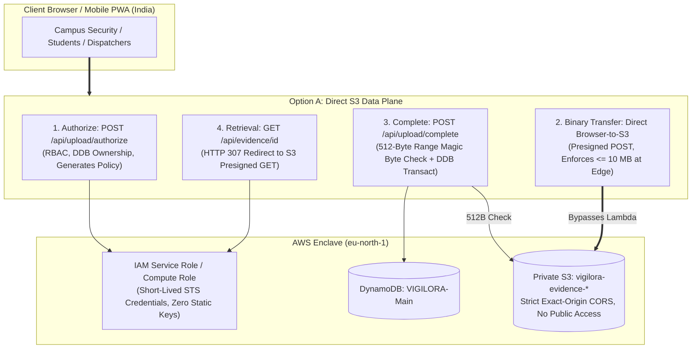
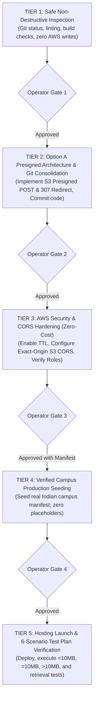

# VIGILORA Phase 4: Production Deployment & Launch Master Plan (Revised)

**Document**: `VIGILORA_PHASE4_PRODUCTION_PLAN.md`  
**Revision**: 2.1 (Incorporating Option A Direct S3 Presigned Architecture & Limits Clarification)  
**Date**: November 3, 2026  
**Status**: STRATEGIC PROPOSAL — PENDING USER APPROVAL  
**Mandate**: Zero code modifications, zero credential creation, zero AWS mutations, zero resource deployment.

---

## 1. Executive Summary & Core Revisions

This revised plan addresses the critical operational, legal, financial, architectural, and geographical realities of deploying **VIGILORA** for production campus dispatch:

1. **Option A Direct S3 Upload Architecture**: Preserves the **10 MB evidence upload limit** by adopting direct browser-to-S3 uploads with short-lived Presigned POST permissions and 307 temporary redirects for evidence viewing, bypassing serverless request and response payload limits.
2. **Infrastructure Ceilings Clarification**: Disentangles the verified **6 MB AWS Lambda synchronous request payload limit** from the documented **5.72 MB (6,000,000 bytes) AWS Amplify SSR maximum response payload limit**.
3. **Next.js 16.4.3 Compatibility Realities**: Details that custom build configurations (`nvm use 22`) do not solve underlying framework adapter limitations on Amplify; provides AWS App Runner as the 100% native containerized fallback.
4. **Rejection of Long-Lived IAM Keys**: Permanent access keys (`AKIA...`) are replaced with native IAM compute roles or OpenID Connect (OIDC) federated identity.
5. **Disqualification of Vercel Hobby**: Vercel Hobby is legally barred for institutional/commercial use and technically fails the 10 MB evidence requirement due to a 4.5 MB Serverless payload limit.
6. **Fictional Data Isolation**: All placeholder names, emails, and US hotlines (`+1 (555)...`) are strictly quarantined. No data will be written to DynamoDB without verified Indian campus specifications.
7. **Stockholm (`eu-north-1`) vs. India Assessment**: Technical evaluation of the ~130–170ms round-trip latency to Stockholm and DPDPA 2023 data residency implications.
8. **Cost Transparency & Feature Gating**: Clear distinction between free features and paid AWS capabilities (PITR, S3 versioning, WAF, CloudWatch alarms).
9. **Strict Tiered Action Gating**: Separation of safe, read-only inspection tasks from irreversible state changes (commits, AWS updates, deployments).

---

## 2. Hosting Architecture Evaluation & Comparison



### Detailed Platform Comparison Matrix

| Evaluation Criteria | Vercel Hobby Tier | AWS Amplify Hosting (SSR) + Option A | AWS App Runner (Container) + Option A |
| :--- | :--- | :--- | :--- |
| **Legal / Terms of Service** | ❌ **Disqualified**: Section 1 strictly prohibits commercial, institutional, or university campus operations. | ✅ **Compliant**: Standard AWS commercial terms; educational & enterprise permitted. | ✅ **Compliant**: Full AWS commercial terms. |
| **Request Payload Ceiling** | ❌ **Fails**: Hard 4.5 MB Serverless function payload limit rejects 10 MB photos. | ✅ **Bypassed via Option A**: Direct browser-to-S3 Presigned POST bypasses 6 MB Lambda limit; S3 enforces `content-length-range <= 10 MB`. | ✅ **Passes**: Direct S3 Presigned POST bypasses container; proxy supports up to 100 MB. |
| **Response Payload Ceiling** | ❌ **Fails**: Serverless response buffering. | ✅ **Bypassed via Option A**: Canonical route returns HTTP 307 Redirect (~350 bytes), bypassing Amplify's 5.72 MB response limit. | ✅ **Passes**: Direct S3 Presigned GET / 307 redirect. |
| **Next.js 16.4.3 Compatibility** | Native (Vercel-owned) | ⚠️ **Experimental**: Officially documents support up to Next.js 15. Requires disabling experimental PPR. | ✅ **100% Native**: Runs standalone Node 22 server in Docker container; zero serverless adapter quirks. |
| **Credential Strategy** | ⚠️ Requires long-lived IAM machine keys stored in third-party env. | ✅ **Zero Secrets**: Uses native AWS IAM execution role attached to Amplify compute. | ✅ **Zero Secrets**: Uses native IAM instance role. |
| **Colocation Latency** | ⚠️ External network hops to AWS `eu-north-1`. | ✅ **Colocated**: Runs directly inside AWS `eu-north-1` alongside DynamoDB/S3. | ✅ **Colocated** in `eu-north-1`. |
| **Monthly Cost** | $0.00 (Breaches TOS if used) | **$0.00** on AWS 12-month Free Tier. | ~$5.00–$10.00/mo (Minimal charge for standalone compute). |
| **Maintenance Burden** | Zero maintenance | Zero maintenance (Fully managed Git CI/CD) | Low maintenance (Automatic container deployment). |

---

## 3. Secure Credential Strategy: Elimination of Permanent Access Keys

Permanent IAM access keys (`AKIA...`) create perpetual leakage risks. VIGILORA Phase 4 mandates **short-lived, role-based credentials**:

### Option 1: Native AWS Compute IAM Execution Role (Primary Recommendation)
When hosted on AWS Amplify or App Runner:
- No `AWS_ACCESS_KEY_ID` or `AWS_SECRET_ACCESS_KEY` is ever created or stored in environment variables.
- The compute instance automatically queries the AWS Instance Metadata Service (IMDSv2) to obtain temporary security credentials via AWS STS that rotate every 15–60 minutes.
- The AWS SDK v3 in Node.js automatically retrieves these credentials transparently.

### Option 2: OpenID Connect (OIDC) Federated Identity (If Using External CI/CD)
If GitHub Actions or an external CI runner builds the application:
- GitHub Actions assumes an IAM Role via STS `AssumeRoleWithWebIdentity` using cryptographically signed JWT tokens issued by GitHub.
- Temporary credentials valid only for the duration of the deployment build job (max 1 hour) are issued. Zero secrets stored in repository secrets.

---

## 4. Indian Campus Context: Latency, Data Residency & Compliance

### 4.1 Latency Analysis (`eu-north-1` Stockholm vs. India)
- **Current Physical State**: The existing `VIGILORA-Main` table and `vigilora-evidence-*` bucket are located in **Stockholm (`eu-north-1`)**.
- **Network Latency**:
  - Round-Trip Time (RTT) from Indian metropolitan regions (Delhi, Mumbai, Bangalore) to Stockholm is **130ms – 170ms**.
  - Direct browser-to-S3 uploads over HTTPS take ~2–3 seconds for a full 10 MB image on standard Indian broadband.
- **Decision Gate**:
  - *Phase 4 Launch*: Proceed with existing `eu-north-1` resources to eliminate migration risks and remain within verified infrastructure.
  - *Post-Launch Optimization*: Future phases may migrate tables and buckets to `ap-south-1` (Mumbai) if latency or institutional regulations dictate.

### 4.2 Data Residency & DPDPA 2023 Considerations
- Under India's **Digital Personal Data Protection Act (DPDPA) 2023**:
  - Incident reports containing photographic evidence and location logs constitute personal data.
  - Cross-border transfer of personal data is permitted to countries not blacklisted by the Central Government, provided institutional campus data governance approves storage in the European Union (GDPR data protection equivalence).
  - **Requirement**: Campus IT / legal administration must acknowledge that evidence data is hosted in AWS Region `eu-north-1` (Stockholm, Sweden).

---

## 5. Cost Transparency: Free Capabilities vs. Paid AWS Services

### 5.1 Truly Free / Free-Tier Capabilities ($0.00)
- **DynamoDB Core**: 25 GB of storage, 25 provisioned WCU/RCU (or Free Tier on-demand allocations up to 2.5M reads/writes).
- **DynamoDB TTL**: **100% Free**. Scanning and deletion of expired session items incurs zero read or write charges.
- **S3 Standard Storage**: Free Tier includes 5 GB storage, 20,000 GET requests, 2,000 PUT requests per month for the first 12 months.
- **IAM (Identity & Access Management)**: **100% Free**. Role creation, policies, and STS assume-role calls are never charged.
- **ACM (AWS Certificate Manager)**: Free public SSL/TLS certificates for custom domains.

### 5.2 Paid Features (Disabled by Default — Requires Explicit Approval)
- **DynamoDB Point-In-Time Recovery (PITR)**: **PAID** (~$0.20 per GB/month). *Status: DISABLED.*
- **DynamoDB On-Demand Backups**: **PAID** ($0.10 per GB/month). *Status: DISABLED.*
- **S3 Object Versioning**: **PAID Accumulator**. *Status: DISABLED.*
- **S3 Lifecycle Transitions to Glacier**: **PAID Request Fees**. *Status: DISABLED.*
- **AWS WAF (Web Application Firewall)**: **PAID** ($5.00/month per WebACL + $1.00/rule/month). *Status: DISABLED.*
- **AWS CloudWatch Alarms & Custom Metrics**: First 10 alarms are free. *Status: LIMITED TO FREE TIER ONLY.*

---

## 6. Real Campus Personnel Manifest: Quarantine of Placeholders

All placeholder names and US phone numbers from prior integration phases are **strictly quarantined**. No accounts or teams will be seeded until the user provides verified campus data:

```
[CAMPUS SPECIFICATION MANIFEST]
Campus Name:                [e.g. Indian Institute of Technology / University Campus]
Campus Location / City:     [e.g. New Delhi / Bengaluru / Pune]
Local Timezone:             [e.g. Asia/Kolkata (IST, UTC+5:30)]
Emergency Hotline (India):  [e.g. +91 XX XXXX XXXX or internal EPABX extension]
Primary Radio Channel:      [e.g. DISPATCH-CAMPUS-1 (460.125 MHz)]

[PERMANENT OPERATORS TO PROVISION]
1. Chief / Supervisor:      [Full Name] | [Official Campus Email] | [Callsign]
2. Shift Supervisor:        [Full Name] | [Official Campus Email] | [Callsign]
3. Lead Dispatcher:         [Full Name] | [Official Campus Email] | [Callsign]
4. Lead Responder:          [Full Name] | [Official Campus Email] | [Callsign]

[TACTICAL RESPONSE UNITS TO PROVISION]
Unit 1 (Security):          [Unit Name] | [Callsign] | [Assigned Sector] | [Members Count]
Unit 2 (Medical):           [Unit Name] | [Callsign] | [Assigned Sector] | [Members Count]
Unit 3 (Fire/Hazard):       [Unit Name] | [Callsign] | [Assigned Sector] | [Members Count]
Unit 4 (Patrol/Crowd):      [Unit Name] | [Callsign] | [Assigned Sector] | [Members Count]
```

---

## 7. Action Gate Tiers: Separation of Safe Inspection vs. Irreversible Actions



### Tier 1: Safe, Non-Destructive Inspection (Zero Risk)
- Audit git repository status and file integrity.
- Run local linting (`eslint`) and typechecking (`tsc --noEmit`).
- Prepare campus manifest questionnaire.
- **State Changes**: NONE.

### Tier 2: Option A Implementation & Source Consolidation (Low Risk)
- Add `@aws-sdk/s3-presigned-post` and `@aws-sdk/s3-request-presigner`.
- Implement `POST /api/upload/authorize` with `createPresignedPost` (enforcing `content-length-range: [1, 10485760]`).
- Implement `POST /api/upload/complete` with 512-byte Range magic-byte verification and DynamoDB transaction.
- Update `GET /api/evidence/[id]` to return `HTTP 307 Temporary Redirect` to a short-lived presigned GET URL.
- Update frontend `report/page.tsx` to execute direct S3 upload via `FormData`.
- Stage and commit verified code to Git.
- **State Changes**: Application code and local Git repository.

### Tier 3: AWS Security Hardening & CORS Configuration (Zero-Cost Features Only)
- Review and enable DynamoDB native TTL on `expiresAt` attribute of `VIGILORA-Main` (100% Free).
- Configure S3 exact-origin CORS on `vigilora-evidence-*` (strictly allowing production origin and `localhost:3000`).
- Attach least-privilege IAM service role to compute.
- Ensure PITR, S3 versioning, and WAF remain disabled.
- **State Changes**: DynamoDB table setting update and S3 CORS configuration.

### Tier 4: Verified Production Campus Seeding (Targeted Data State)
- Review user-supplied Campus Specification Manifest.
- Execute verified seeding script to populate permanent operators with cryptographically salted scrypt hashes and initial secure passkeys.
- Verify live DynamoDB records.
- **State Changes**: DynamoDB data insert under `CAMPUS#...` partition.

### Tier 5: Cloud Deployment & 6-Scenario Test Plan Verification
- Link repository to chosen hosting platform (Amplify Hosting or App Runner).
- Inject verified environment variables (`NEXT_PUBLIC_APP_URL`, `AWS_REGION=eu-north-1`, etc.).
- Execute 6-scenario verification test plan:
  1. TC-1: Standard 2.5 MB image upload and retrieval.
  2. TC-2: Boundary test at exactly 10.0 MB (10,485,760 bytes).
  3. TC-3: Boundary test at 10 MB + 1 byte (10,485,761 bytes) verifying rejection.
  4. TC-4: Substantial oversize test (25 MB) verifying edge termination.
  5. TC-5: Magic byte tampering check (fake executable renamed to `.jpg`).
  6. TC-6: Retrieval test of > 5.72 MB image verifying 307 redirect and zero 504 timeouts.
- **State Changes**: Live web deployment accessible via HTTPS.

---

## 8. Summary of Safeguards

1. **No Code Modified**: Application codebase remains unchanged during planning.
2. **No Credentials Minted**: No long-lived access keys generated.
3. **No AWS Resources Mutated**: DynamoDB and S3 configurations remain untouched until Tier 3.
4. **No Placeholders Seeded**: Fictional names/numbers are barred from production tables.
5. **Zero Paid Services**: All billable AWS services (PITR, Versioning, WAF) are explicitly blocked.

---

**Next Action**: Awaiting operator review of this revised plan, selection of the preferred hosting path (AWS Amplify Free Tier vs. AWS App Runner Container), and delivery of the verified campus intake manifest.
